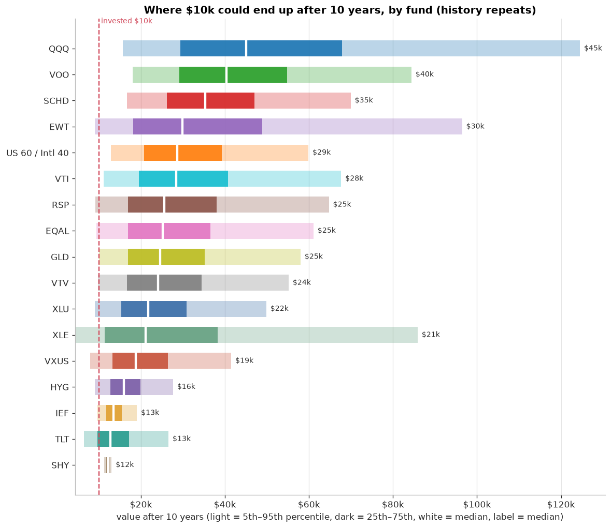
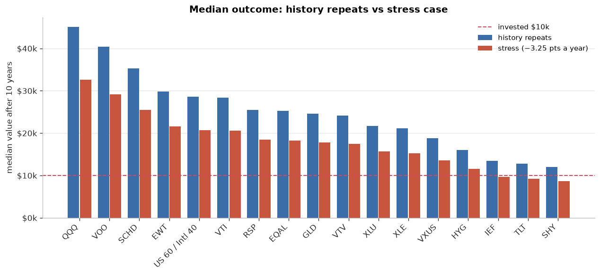
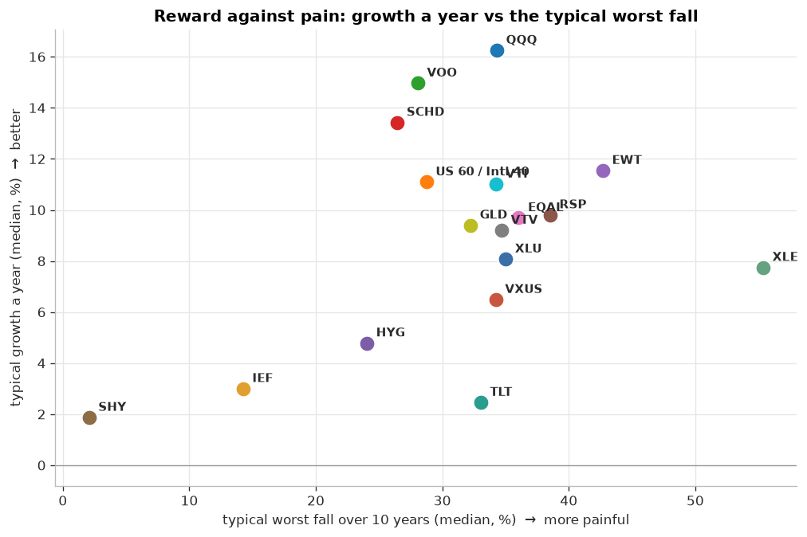
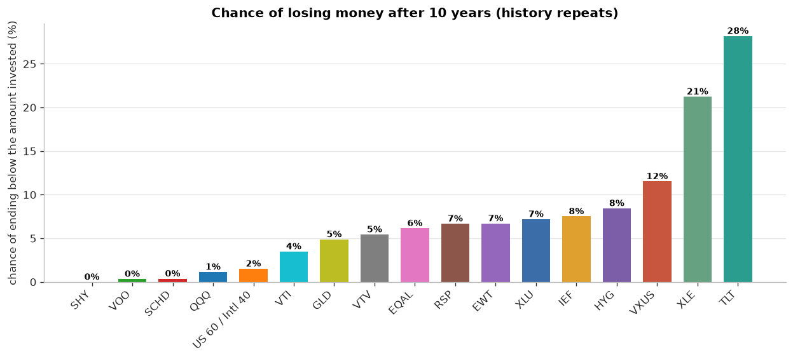
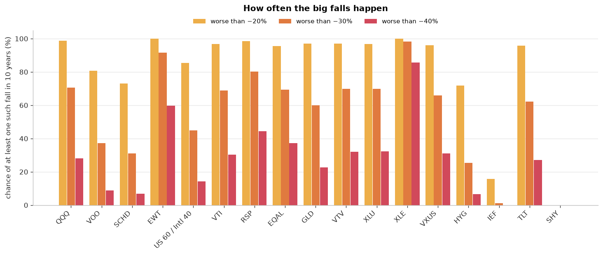
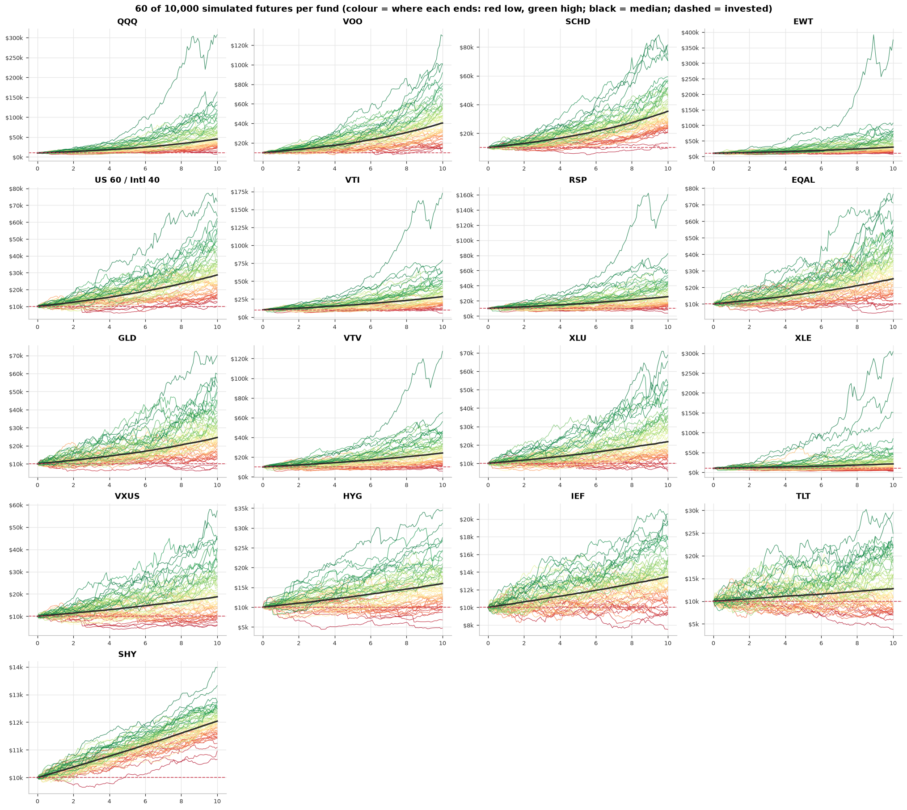
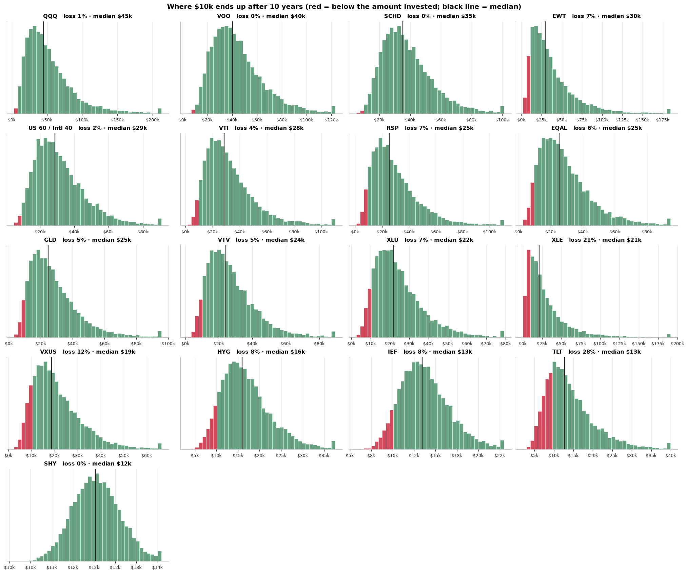
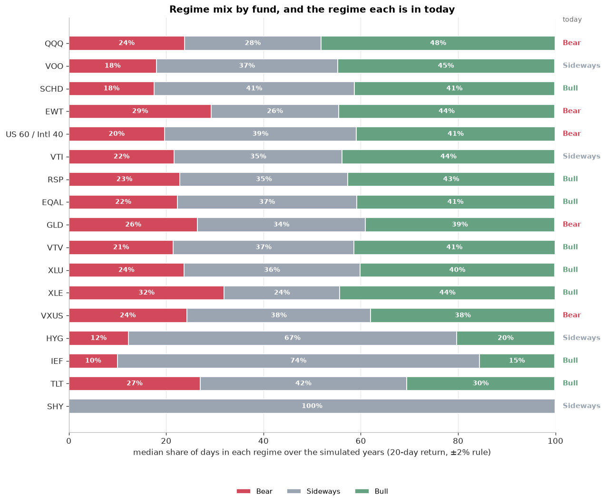
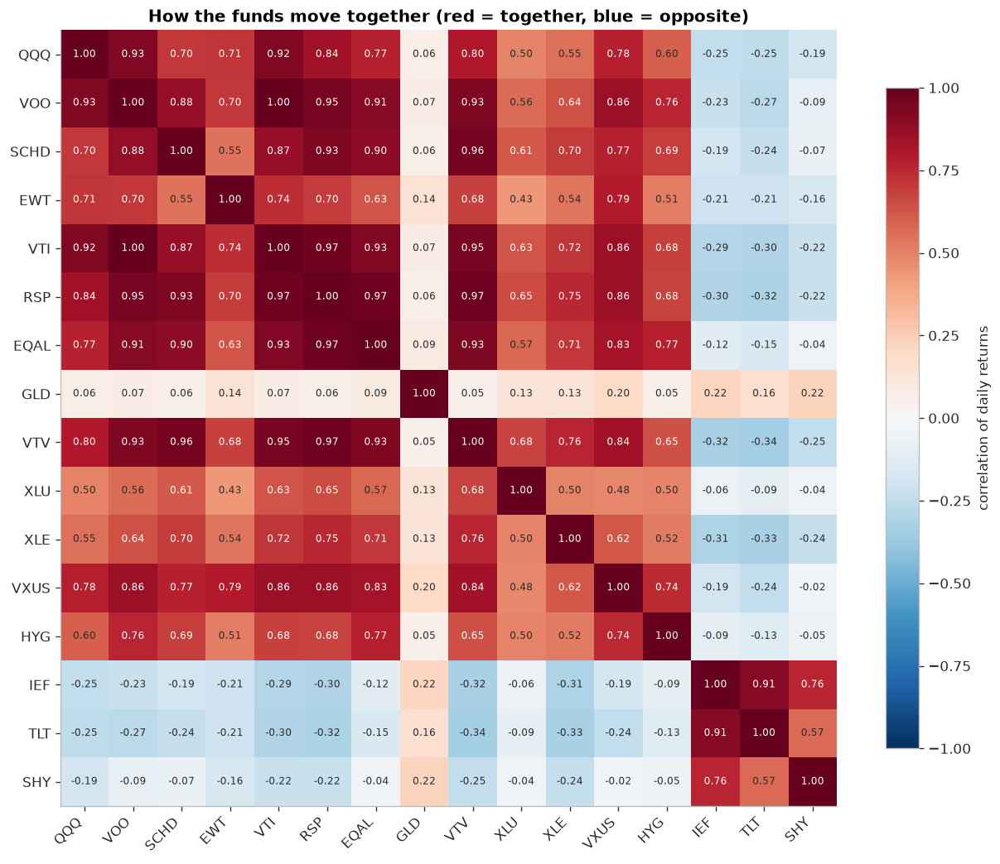

# ETF Monte Carlo research

Updated 2026-11-01 01:22 UTC · **$10,000 today**, over **10 years** · 10,000 simulated futures per fund · blocks of 20 real trading days · seed 42

> Research tool, not advice. Every future here is stitched together from each fund's own past, so it shows what the past implies, not what will happen.

**Contents:** [At a glance](#at-a-glance) · [1. Outcomes](#1-outcomes) · [2. Risk and return](#2-risk-and-return) · [3. Simulated futures](#3-simulated-futures) · [4. Distributions](#4-distributions) · [5. Regimes](#5-regimes) · [6. Diversification](#6-diversification) · [7. The data used](#7-the-data-used) · [8. Limits](#8-limits) · [Files](#files)

## At a glance

Ranked by median value after 10 years if history repeats. Total invested: $10,000.

| # | Fund | What it is | Median value | 5th – 95th | Growth a year (median) | Chance of loss | Typical worst fall | Fall worse than −30% | Median if −3.25 pts a year | Today |
|---|---|---|---|---|---|---|---|---|---|---|
| 1 | **QQQ** | US tech-heavy (Nasdaq-100; same index as QQQM, longer history) | **$45,083** | $15,633 – $124,493 | 16.3% | 1% | -34% | 70% | $32,578 | Bear |
| 2 | **VOO** | US large-cap (S&P 500) | **$40,345** | $18,008 – $84,383 | 15.0% | 0% | -28% | 37% | $29,155 | Sideways |
| 3 | **SCHD** | US dividend payers | **$35,266** | $16,665 – $69,913 | 13.4% | 0% | -26% | 31% | $25,484 | Bull |
| 4 | **EWT** | Taiwan | **$29,815** | $8,985 – $96,438 | 11.5% | 7% | -43% | 92% | $21,544 | Bear |
| 5 | **US 60 / Intl 40** | Mix: VOO 60%, VXUS 40% | **$28,634** | $12,861 – $59,857 | 11.1% | 2% | -29% | 45% | $20,691 | Bear |
| 6 | **VTI** | US total market | **$28,418** | $11,101 – $67,649 | 11.0% | 4% | -34% | 69% | $20,535 | Sideways |
| 7 | **RSP** | US equal-weight S&P 500 | **$25,481** | $9,113 – $64,726 | 9.8% | 7% | -39% | 80% | $18,412 | Bull |
| 8 | **EQAL** | US equal-weight Russell 1000 | **$25,219** | $9,358 – $61,058 | 9.7% | 6% | -36% | 69% | $18,223 | Bull |
| 9 | **GLD** | Gold (same exposure as AAAU, longer history) | **$24,564** | $10,056 – $57,980 | 9.4% | 5% | -32% | 60% | $17,750 | Bear |
| 10 | **VTV** | US value | **$24,112** | $9,768 – $55,138 | 9.2% | 5% | -35% | 70% | $17,423 | Bull |
| 11 | **XLU** | US utilities | **$21,745** | $9,015 – $49,820 | 8.1% | 7% | -35% | 70% | $15,712 | Bull |
| 12 | **XLE** | US energy | **$21,098** | $4,279 – $85,857 | 7.8% | 21% | -55% | 98% | $15,244 | Bull |
| 13 | **VXUS** | International excluding the US | **$18,753** | $7,839 – $41,467 | 6.5% | 12% | -34% | 66% | $13,550 | Bear |
| 14 | **HYG** | US high-yield corporate bonds | **$15,963** | $9,060 – $27,621 | 4.8% | 8% | -24% | 25% | $11,534 | Sideways |
| 15 | **IEF** | US Treasuries, 7-10 years | **$13,444** | $9,594 – $19,019 | 3.0% | 8% | -14% | 1% | $9,714 | Bull |
| 16 | **TLT** | US Treasuries, 20+ years | **$12,751** | $6,413 – $26,534 | 2.5% | 28% | -33% | 62% | $9,213 | Bull |
| 17 | **SHY** | US Treasuries, 1-3 years (near cash) | **$12,038** | $11,172 – $13,002 | 1.9% | 0% | -2% | 0% | $8,698 | Sideways |

*Typical worst fall* = the median, across futures, of the largest peak-to-trough fall. *Today* = the regime from the last 20 trading days (Bull above +2%, Bear below −2%).

## 1. Outcomes

## 2. Risk and return

Up and to the left is better: more growth for a smaller typical fall.

## 3. Simulated futures

## 4. Distributions

## 5. Regimes

## 6. Diversification

Low or negative correlation means two funds tend not to fall on the same days, which is what makes combining them useful.

## 7. The data used

Each fund is simulated from its own history. Funds with short histories have seen fewer kinds of markets, so treat them with more caution.

| Fund | History used | Years | Growth a year | Volatility | Worst fall |
|---|---|---|---|---|---|
| QQQ | 2006-11-02 to 2026-10-30 | 20.0 | 16.0% | 22.1% | -53% |
| VOO | 2010-09-10 to 2026-10-30 | 16.1 | 14.7% | 16.9% | -34% |
| SCHD | 2011-10-21 to 2026-10-30 | 15.0 | 13.8% | 15.3% | -33% |
| EWT | 2006-11-02 to 2026-10-30 | 20.0 | 11.4% | 25.6% | -63% |
| US 60 / Intl 40 | 2011-01-31 to 2026-10-30 | 15.7 | 11.0% | 16.7% | -34% |
| VTI | 2006-11-02 to 2026-10-30 | 20.0 | 10.9% | 19.6% | -55% |
| RSP | 2006-11-02 to 2026-10-30 | 20.0 | 9.9% | 20.7% | -60% |
| EQAL | 2014-12-26 to 2026-10-30 | 11.8 | 9.3% | 18.3% | -40% |
| GLD | 2006-11-02 to 2026-10-30 | 20.0 | 9.2% | 18.2% | -46% |
| VTV | 2006-11-02 to 2026-10-30 | 20.0 | 9.3% | 19.3% | -59% |
| XLU | 2006-11-02 to 2026-10-30 | 20.0 | 8.2% | 19.0% | -46% |
| XLE | 2006-11-02 to 2026-10-30 | 20.0 | 7.9% | 30.0% | -71% |
| VXUS | 2011-01-31 to 2026-10-30 | 15.7 | 6.4% | 17.7% | -36% |
| HYG | 2007-04-12 to 2026-10-30 | 19.5 | 4.8% | 10.8% | -34% |
| IEF | 2006-11-02 to 2026-10-30 | 20.0 | 3.1% | 6.9% | -24% |
| TLT | 2006-11-02 to 2026-10-30 | 20.0 | 2.7% | 15.0% | -48% |
| SHY | 2006-11-02 to 2026-10-30 | 20.0 | 1.9% | 1.5% | -6% |

## 8. Limits

- The past is the only source of randomness. A decade dominated by one kind of market (for example falling rates, or a long US rally) shapes every simulated future.
- Funds with different history lengths are compared side by side; the longer ones include crises the shorter ones never saw.
- Blocks of 20 days keep short-term momentum and volatility clustering, but nothing longer than a block.
- No taxes, fees beyond those already in the fund prices, currency effects beyond what is in the price, or inflation.
- The stress case simply subtracts 3.25 points a year from every fund; it is a sensitivity check, not a forecast.

## Files

Charts are sorted into one folder per category; the CSV tables hold every number above.

- **1. Overview:** [`outcome_ranges.png`](charts/1_overview/outcome_ranges.png), [`history_vs_stress.png`](charts/1_overview/history_vs_stress.png)
- **2. Risk and return:** [`growth_vs_worst_fall.png`](charts/2_risk_return/growth_vs_worst_fall.png), [`chance_of_loss.png`](charts/2_risk_return/chance_of_loss.png), [`chance_of_big_falls.png`](charts/2_risk_return/chance_of_big_falls.png)
- **3. Simulated futures:** [`simulated_futures_all_funds.png`](charts/3_paths/simulated_futures_all_funds.png)
- **4. Distributions:** [`outcome_distributions.png`](charts/4_distributions/outcome_distributions.png)
- **5. Regimes:** [`regime_mix.png`](charts/5_regimes/regime_mix.png)
- **6. Diversification:** [`correlation_heatmap.png`](charts/6_diversification/correlation_heatmap.png)
- **Tables:** [`fund_summary.csv`](tables/fund_summary.csv), [`correlation.csv`](tables/correlation.csv)
