# Cash-flow Monte Carlo: results

Updated 2026-11-01 01:09 UTC · **10,000 simulated futures** · seed 42 · blocks of 20 real trading days resampled from 2014-12-26 to 2026-10-30 (2,979 trading days)

> ⚠️ **Placeholder allocation.** The sleeve weights and glide path in this run are illustrative inputs that show how the model works. They are not a recommendation; the strategy's allocation is the team's own decision.

**Contents:** [At a glance](#at-a-glance) · [1. Inputs](#1-inputs) · [2. Simulated futures](#2-simulated-futures) · [3. Where it ends up](#3-where-the-portfolio-ends-up) · [4. Funding and contribution](#4-funding-reliability-and-the-facility-contribution) · [5. Risk](#5-risk) · [6. Limits](#6-limits) · [Files](#files)

## At a glance

| Measure | history | stress |
|---|---|---|
| Median value on 1 Jan 2033 | **$592,135** | **$542,810** |
| 5th – 95th percentile | $429,265 – $809,032 | $394,991 – $738,861 |
| Chance of falling short of the reserve (earning 2%) | 9.6% | 18.9% |
| Chance of falling short of the reserve (earning 3%) | 6.3% | 13.5% |
| Chance of falling short of the reserve (earning 4%) | 4.3% | 9.8% |
| Median facility contribution (reserve at 3%) | $152,829 | $103,504 |
| Contribution with 90% confidence ≥ (reserve at 3%) | **$20,987** | **−$15,989** |
| Chance of a fall worse than −20% in 2031–2032 | 1.2% | 1.7% |

## 1. Inputs

| Item | Value |
|---|---|
| Contribution on 1 Jan 2027 | $300,000 |
| Contribution on 1 Jan 2028 | $150,000 |
| Valuation date | 1 Jan 2033 |
| Operating payments | 10 × $50,000, at the start of each year (annuity-due) |
| Flexibility amount held back | $0 |

| Sleeve | Holdings (weights inside the sleeve) |
|---|---|
| Growth | EQAL 50%, VXUS 50% |
| Matching | IEF 100% |
| Flex | SHY 100% |

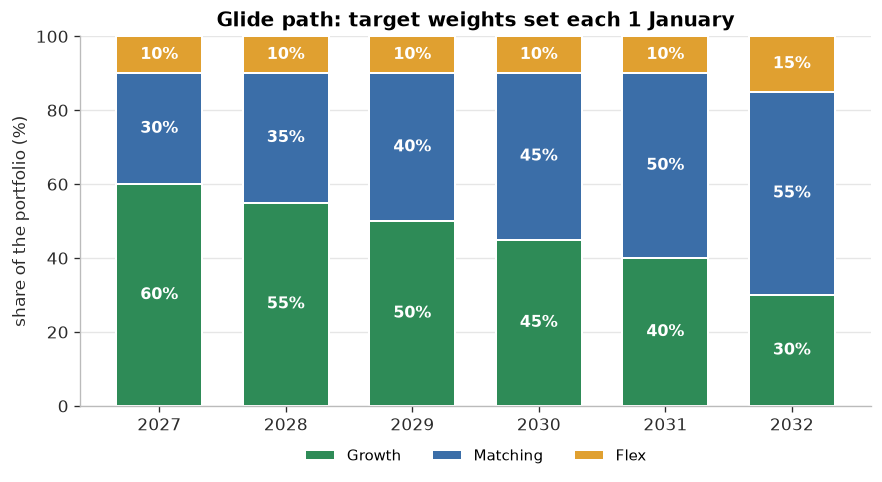

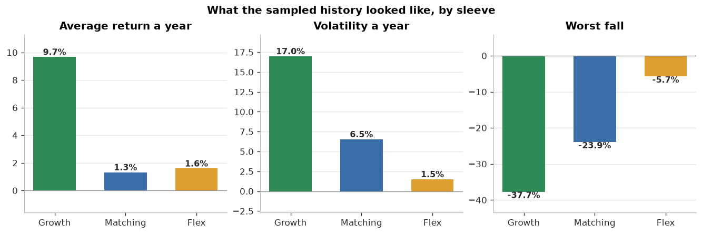

| Sleeve | Average return a year | Volatility a year | Worst fall |
|---|---|---|---|
| Growth | 9.7% | 17.0% | -38% |
| Matching | 1.3% | 6.5% | -24% |
| Flex | 1.6% | 1.5% | -6% |

## 2. Simulated futures

Each line is one possible future for the portfolio, coloured by where it ends (red = low, green = high). The step in early 2028 is the second contribution.

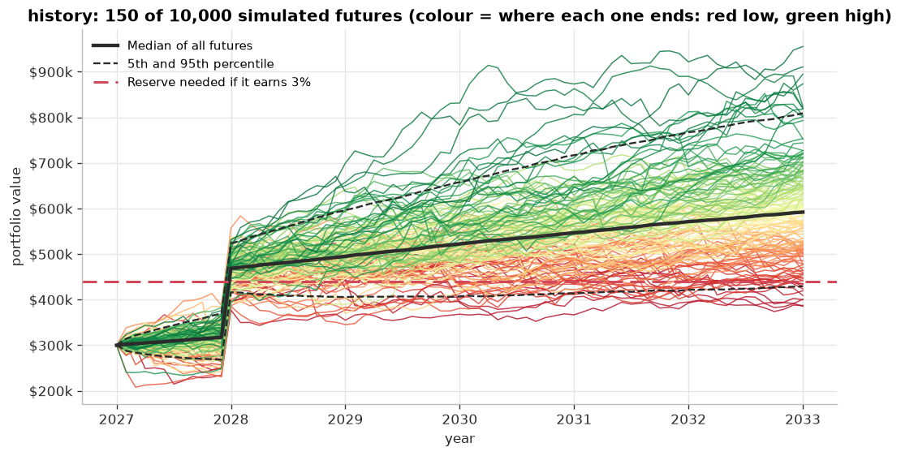

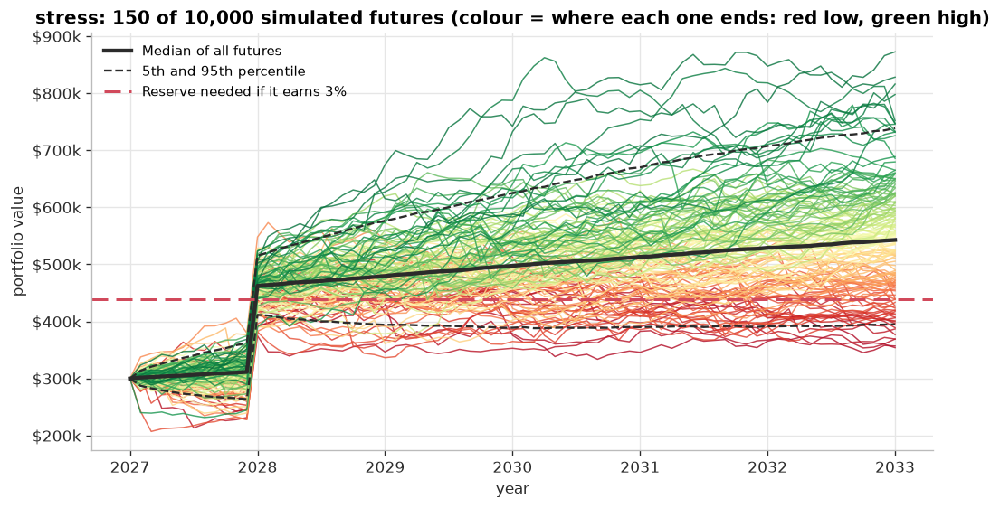

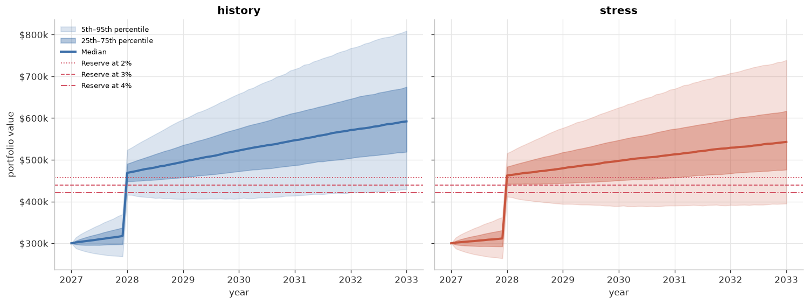

## 3. Where the portfolio ends up

Bars are coloured against the reserve needed if it earns 3% ($439,305): red below it, amber up to 10% above it, green more than 10% above.

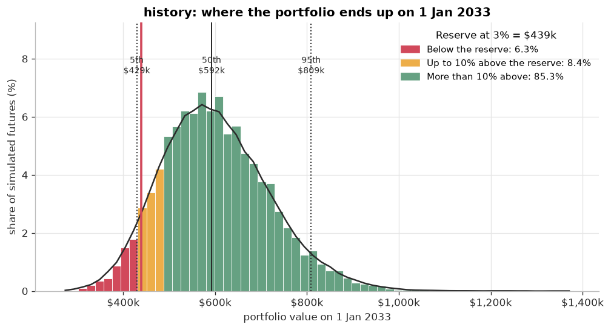

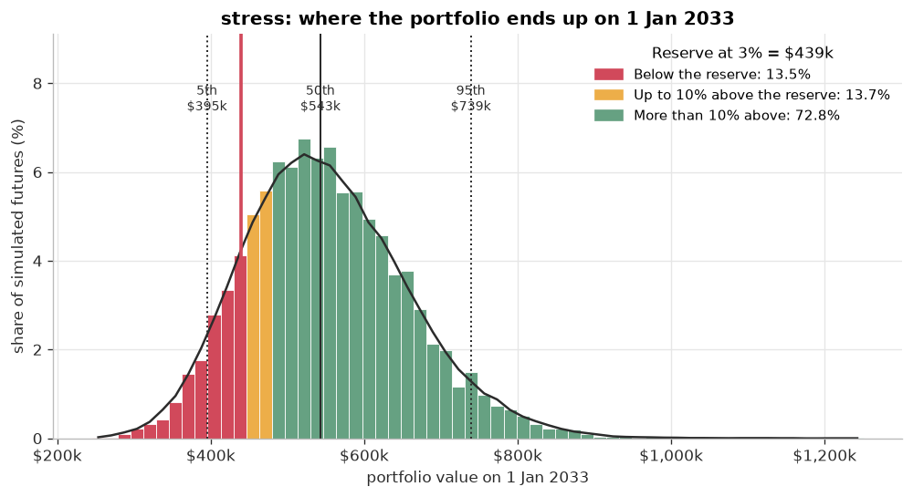

| Scenario | Date | 5th | 25th | Median | 75th | 95th |
|---|---|---|---|---|---|---|
| history | 1 Jan 2031 | $413,958 | $486,967 | $546,930 | $612,595 | $717,043 |
| history | 1 Jan 2033 | $429,265 | $519,218 | $592,135 | $674,667 | $809,032 |
| stress | 1 Jan 2031 | $390,176 | $457,756 | $513,139 | $574,108 | $669,908 |
| stress | 1 Jan 2033 | $394,991 | $476,419 | $542,810 | $616,960 | $738,861 |

## 4. Funding reliability and the facility contribution

Reserve = present value of the payments at the assumed reserve return (closed form). Contribution = portfolio value − reserve − flexibility amount.

| Reserve earns | Reserve needed |
|---|---|
| 2% | $458,112 |
| 3% | $439,305 |
| 4% | $421,767 |

For scale: the contributions add up to $450,000 even if they earn nothing.

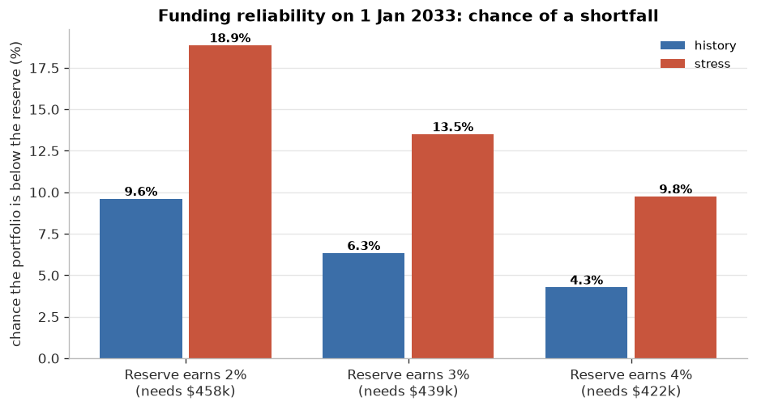

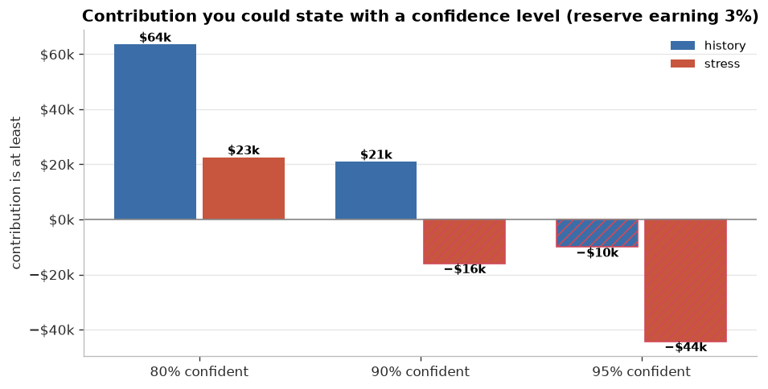

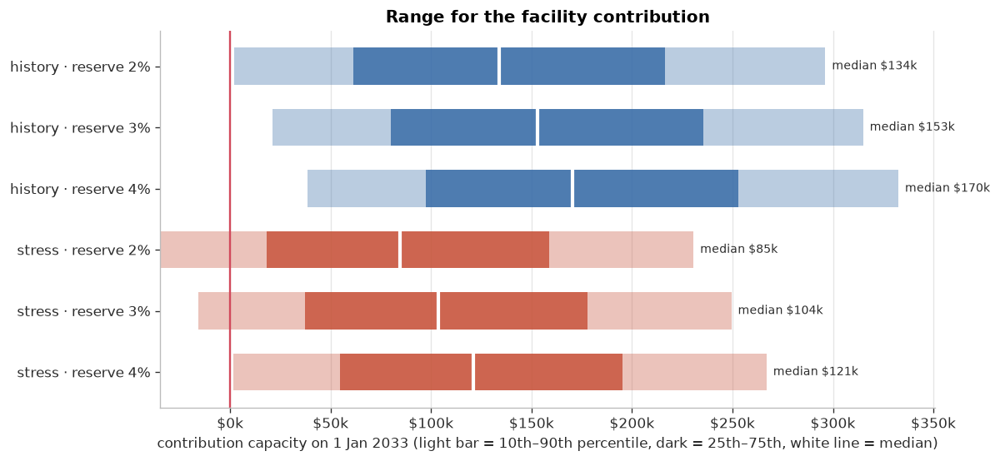

| Scenario | Reserve earns | Funding ratio 10th / median | Chance below reserve | Contribution 10th / median / 90th | ≥ with 80% / 90% / 95% confidence |
|---|---|---|---|---|---|
| history | 2% | 1.00× / 1.29× | 9.62% | $2,180 / $134,023 / $296,216 | $44,743 / $2,180 / −$28,847 |
| history | 3% | 1.05× / 1.35× | 6.35% | $20,987 / $152,829 / $315,022 | $63,549 / $20,987 / −$10,040 |
| history | 4% | 1.09× / 1.40× | 4.28% | $38,526 / $170,368 / $332,561 | $81,088 / $38,526 / $7,499 |
| stress | 2% | 0.92× / 1.18× | 18.87% | −$34,796 / $84,698 / $230,612 | $3,784 / −$34,796 / −$63,121 |
| stress | 3% | 0.96× / 1.24× | 13.51% | −$15,989 / $103,504 / $249,419 | $22,590 / −$15,989 / −$44,315 |
| stress | 4% | 1.00× / 1.29× | 9.76% | $1,550 / $121,043 / $266,957 | $40,129 / $1,550 / −$26,776 |

## 5. Risk

### Sequence risk: the largest fall during 2031–2032

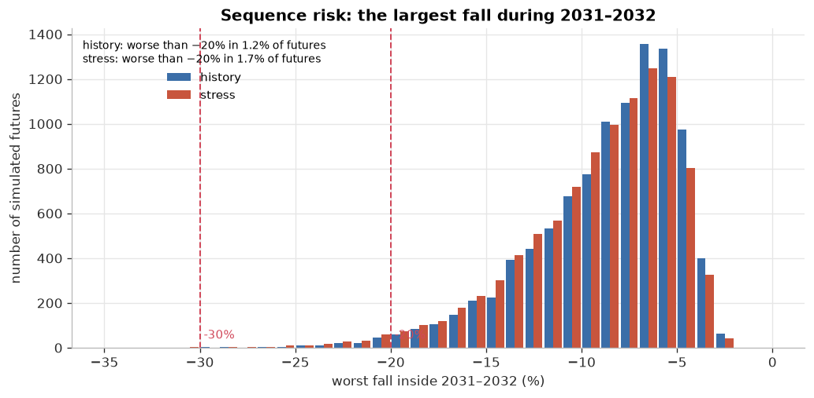

| Scenario | Median worst fall in the window | Worse than −20% | Worse than −30% | Median worst fall, whole period |
|---|---|---|---|---|
| history | -8% | 1.2% | 0.0% | -15% |
| stress | -8% | 1.7% | 0.0% | -16% |

### Regime days of the growth sleeve

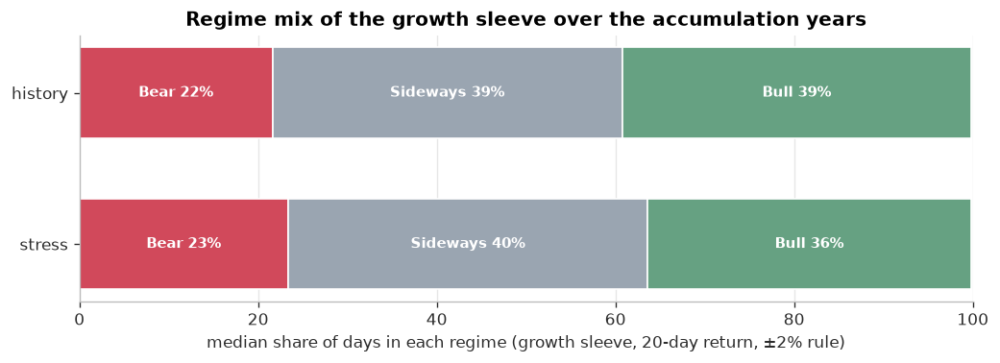

| Scenario | Bear days (5th – median – 95th) | Sideways days | Bull days |
|---|---|---|---|
| history | 229 – 323 – 424 | 498 – 584 – 672 | 471 – 584 – 698 |
| stress | 252 – 349 – 454 | 515 – 601 – 688 | 431 – 540 – 653 |

## 6. Limits

- The sampled history is the only source of randomness. It is limited and spans particular market conditions, so a history-based scenario can flatter or penalise a sleeve.
- Block resampling keeps co-movement and short-term clustering but nothing longer than one block.
- The reserve return is a fixed assumption. Yields available when the reserve is bought are not simulated.
- No taxes, trading costs or inflation. The payments are fixed in nominal terms.
- Results are ranges under stated assumptions, not predictions.

## Files

Charts are sorted into one folder per category; the CSV tables hold every number shown above.

- **1. Inputs:** [`glide_path.png`](charts/1_inputs/glide_path.png), [`sleeve_history.png`](charts/1_inputs/sleeve_history.png)
- **2. Simulated futures:** [`paths_history.png`](charts/2_paths/paths_history.png), [`paths_stress.png`](charts/2_paths/paths_stress.png), [`fan_all_scenarios.png`](charts/2_paths/fan_all_scenarios.png)
- **3. Outcomes:** [`value_2033_history.png`](charts/3_outcomes/value_2033_history.png), [`value_2033_stress.png`](charts/3_outcomes/value_2033_stress.png)
- **4. Funding:** [`shortfall_by_reserve_rate.png`](charts/4_funding/shortfall_by_reserve_rate.png), [`contribution_confidence.png`](charts/4_funding/contribution_confidence.png), [`contribution_ranges.png`](charts/4_funding/contribution_ranges.png)
- **5. Risk:** [`stress_window_drawdown.png`](charts/5_risk/stress_window_drawdown.png), [`regime_days.png`](charts/5_risk/regime_days.png)
- **Tables:** [`portfolio_values.csv`](tables/portfolio_values.csv), [`funding_and_contribution.csv`](tables/funding_and_contribution.csv), [`risk.csv`](tables/risk.csv)
