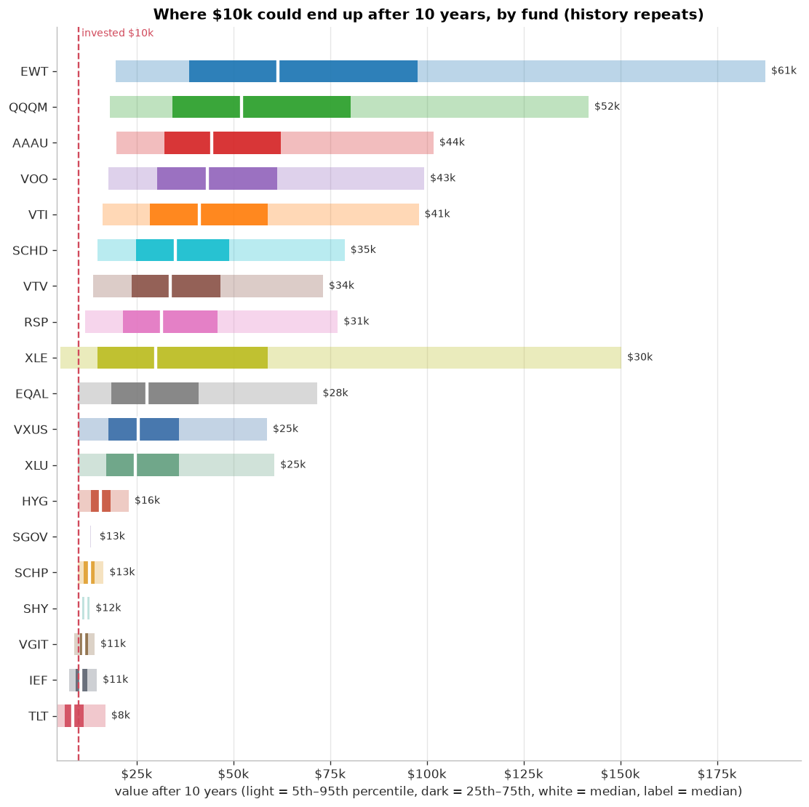
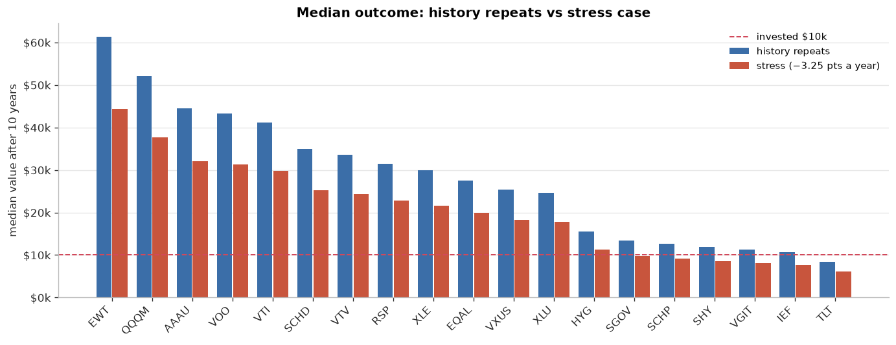
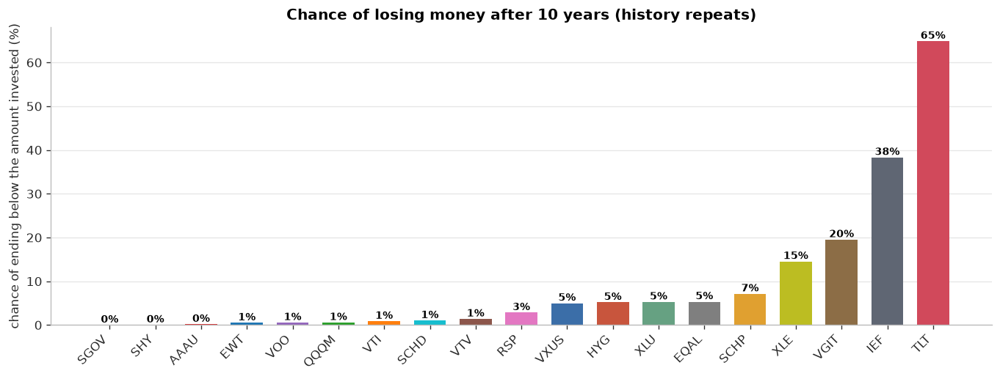
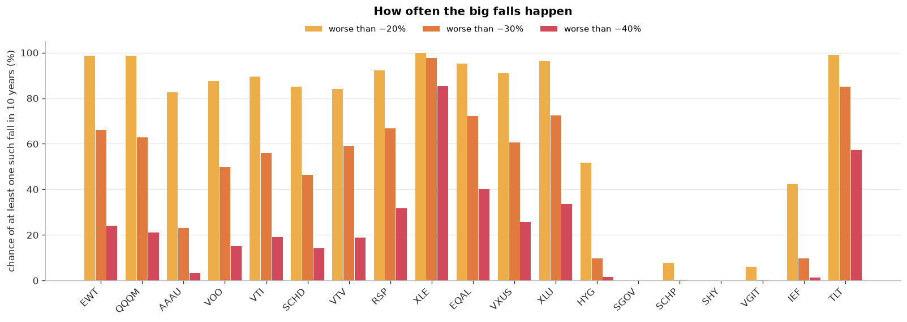
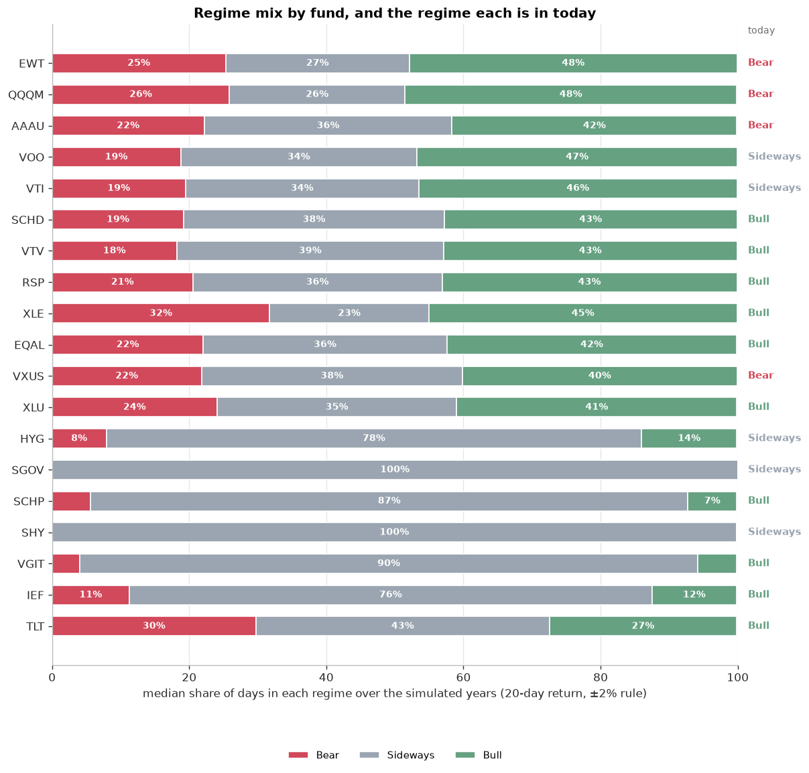
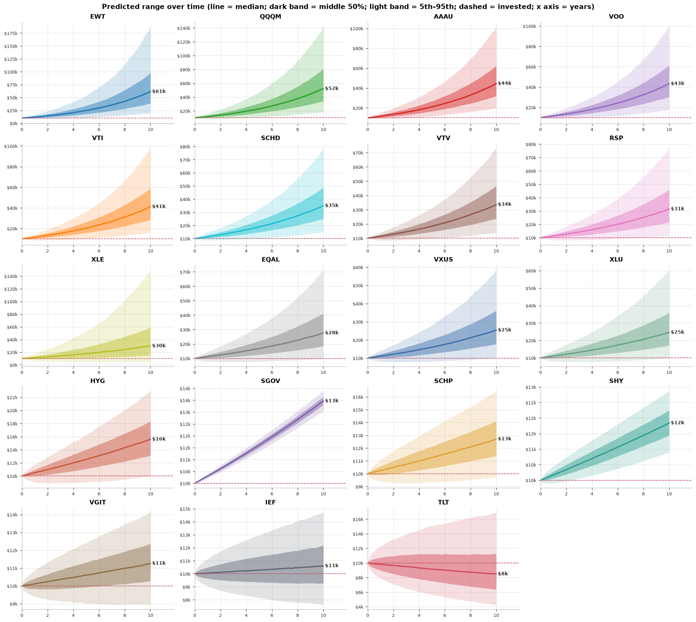
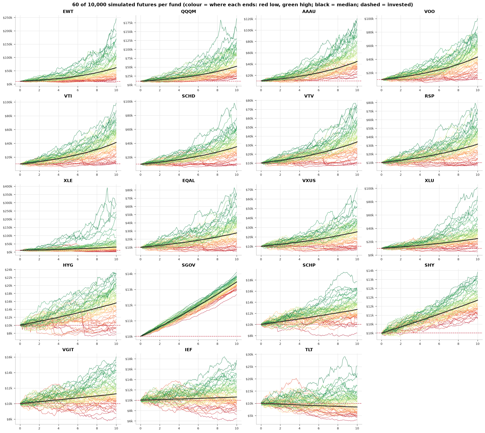
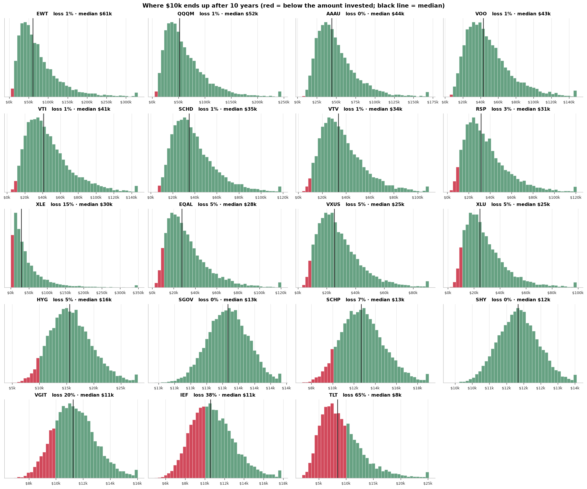

# Monte Carlo: the Markov model ETFs

Updated 2026-11-01 01:41 UTC · **$10,000 today** in each fund, over **10 years** · 10,000 simulated futures per fund · blocks of 20 real trading days · seed 42

> Research tool, not advice. Each fund's futures are stitched together from that fund's own past, so they show what the past implies, not what will happen.

> ⚠ Short history (under 8 years): QQQM, SGOV. These have not been through a full crash cycle, so their predictions are less reliable.

> Window: every fund's last 10 years of Yahoo Finance prices (dividend-adjusted), the same window as the Markov model, so the funds are compared over the same decade. That decade does not include the 2008-09 crash, so falls and chances of loss are likely understated.

**Contents:** [1. Bar diagrams](#1-bar-diagrams) · [2. Simulation prediction](#2-simulation-prediction) · [Notes](#notes)

## 1. Bar diagrams

Funds are sorted by their median value after 10 years if history repeats. Total invested: $10,000.

### 1a. Where the money could end up

### 1b. History repeats vs a tougher future

Blue: futures built from each fund's own past. Red: the same with 3.25 points a year taken off.

### 1c. Chance of losing money

### 1d. How often big falls happen

Chance of at least one peak-to-trough fall of each size during the period.

### 1e. Bull, Sideways and Bear time (same regime rule as the Markov model)

## 2. Simulation prediction

### 2a. Predicted value, median (range in brackets = 5th to 95th percentile)

| Fund | What it is | Year 1 | Year 3 | Year 5 | Year 10 | Growth a year | Chance of loss | Today |
|---|---|---|---|---|---|---|---|---|
| **EWT** | Taiwan | **$11,996** ($8,422 – $16,900) | **$17,173** ($9,324 – $31,556) | **$24,628** ($10,941 – $53,551) | **$61,412** ($19,479 – $187,471) | 19.9% | 1% | Bear |
| **QQQM** | US tech-heavy (Nasdaq-100) | **$11,807** ($8,385 – $16,197) | **$16,497** ($9,180 – $28,844) | **$22,806** ($10,808 – $46,919) | **$52,081** ($18,133 – $141,776) | 17.9% | 1% | Bear |
| **AAAU** | Gold | **$11,588** ($8,941 – $15,122) | **$15,665** ($9,944 – $24,737) | **$21,072** ($11,834 – $37,846) | **$44,455** ($19,846 – $101,707) | 16.1% | 0% | Bear |
| **VOO** | US large-cap (S&P 500) | **$11,693** ($8,733 – $14,755) | **$15,667** ($9,483 – $24,039) | **$20,973** ($10,804 – $36,740) | **$43,268** ($17,679 – $99,315) | 15.8% | 1% | Sideways |
| **VTI** | US total market | **$11,640** ($8,595 – $14,821) | **$15,402** ($9,151 – $23,971) | **$20,361** ($10,275 – $36,666) | **$41,157** ($16,143 – $97,889) | 15.2% | 1% | Sideways |
| **SCHD** | US dividend payers | **$11,424** ($8,665 – $14,341) | **$14,667** ($9,150 – $22,169) | **$18,913** ($10,045 – $32,524) | **$35,009** ($14,957 – $78,746) | 13.3% | 1% | Bull |
| **VTV** | US value | **$11,398** ($8,590 – $14,110) | **$14,502** ($8,896 – $21,634) | **$18,474** ($9,708 – $31,162) | **$33,644** ($13,791 – $73,141) | 12.9% | 1% | Bull |
| **RSP** | US equal-weight S&P 500 | **$11,348** ($8,201 – $14,500) | **$14,241** ($8,230 – $22,570) | **$17,903** ($8,675 – $32,980) | **$31,490** ($11,700 – $76,982) | 12.2% | 3% | Bull |
| **XLE** | US energy | **$11,376** ($6,466 – $17,992) | **$14,161** ($5,319 – $33,081) | **$17,667** ($5,001 – $53,165) | **$29,871** ($5,281 – $150,275) | 11.6% | 15% | Bull |
| **EQAL** | US equal-weight Russell 1000 | **$11,187** ($7,978 – $14,598) | **$13,673** ($7,711 – $22,382) | **$16,757** ($7,782 – $32,280) | **$27,587** ($9,789 – $71,562) | 10.7% | 5% | Bull |
| **VXUS** | International excluding the US | **$11,084** ($8,219 – $14,025) | **$13,299** ($8,074 – $20,567) | **$16,042** ($8,213 – $28,063) | **$25,354** ($10,007 – $58,673) | 9.8% | 5% | Bear |
| **XLU** | US utilities | **$11,051** ($8,174 – $14,185) | **$13,257** ($7,776 – $20,966) | **$15,873** ($8,050 – $29,041) | **$24,603** ($9,874 – $60,599) | 9.4% | 5% | Bull |
| **HYG** | US high-yield corporate bonds | **$10,504** ($9,093 – $11,709) | **$11,463** ($8,925 – $13,995) | **$12,521** ($9,078 – $16,262) | **$15,597** ($9,946 – $22,943) | 4.5% | 5% | Sideways |
| **SGOV** | US Treasury bills, 0-3 months (cash-like) | **$10,303** ($10,198 – $10,400) | **$10,934** ($10,744 – $11,121) | **$11,605** ($11,345 – $11,859) | **$13,468** ($13,049 – $13,886) | 3.0% | 0% | Sideways |
| **SCHP** | US inflation-protected Treasuries (TIPS) | **$10,253** ($9,401 – $11,077) | **$10,732** ($9,268 – $12,347) | **$11,257** ($9,322 – $13,545) | **$12,707** ($9,740 – $16,454) | 2.4% | 7% | Bull |
| **SHY** | US Treasuries, 1-3 years | **$10,168** ($9,906 – $10,442) | **$10,513** ($10,052 – $11,007) | **$10,872** ($10,251 – $11,532) | **$11,840** ($10,884 – $12,869) | 1.7% | 0% | Sideways |
| **VGIT** | US Treasuries, 3-10 years | **$10,116** ($9,405 – $10,859) | **$10,363** ($9,139 – $11,715) | **$10,601** ($9,023 – $12,409) | **$11,259** ($8,944 – $14,115) | 1.2% | 20% | Bull |
| **IEF** | US Treasuries, 7-10 years | **$10,049** ($9,044 – $11,154) | **$10,178** ($8,482 – $12,184) | **$10,281** ($8,147 – $12,932) | **$10,606** ($7,625 – $14,712) | 0.6% | 38% | Bull |
| **TLT** | US Treasuries, 20+ years | **$9,812** ($7,882 – $12,235) | **$9,492** ($6,510 – $13,921) | **$9,136** ($5,681 – $15,052) | **$8,475** ($4,275 – $16,905) | -1.6% | 65% | Bull |

*Today* = regime from the last 20 trading days (Bull above +2%, Bear below −2%).

### 2b. Predicted range over time

### 2c. Sample simulated futures

### 2d. Distribution of final values

## Notes

| Fund | History used | Years | Growth a year | Volatility | Worst fall |
|---|---|---|---|---|---|
| EWT | 2016-11-02 to 2026-10-30 | 10.0 | 18.5% | 22.4% | -39% |
| QQQM | 2020-10-14 to 2026-10-30 | 6.0 ⚠ short | 15.9% | 22.2% | -35% |
| AAAU | 2018-08-16 to 2026-10-30 | 8.2 | 15.5% | 17.5% | -28% |
| VOO | 2016-11-02 to 2026-10-30 | 10.0 | 15.5% | 18.0% | -34% |
| VTI | 2016-11-02 to 2026-10-30 | 10.0 | 15.0% | 18.3% | -35% |
| SCHD | 2016-11-02 to 2026-10-30 | 10.0 | 13.8% | 16.8% | -33% |
| VTV | 2016-11-02 to 2026-10-30 | 10.0 | 13.1% | 16.6% | -37% |
| RSP | 2016-11-02 to 2026-10-30 | 10.0 | 12.4% | 18.3% | -39% |
| XLE | 2016-11-02 to 2026-10-30 | 10.0 | 11.9% | 29.6% | -67% |
| EQAL | 2016-11-02 to 2026-10-30 | 10.0 | 10.8% | 18.8% | -40% |
| VXUS | 2016-11-02 to 2026-10-30 | 10.0 | 9.1% | 17.0% | -36% |
| XLU | 2016-11-02 to 2026-10-30 | 10.0 | 9.4% | 19.3% | -36% |
| HYG | 2016-11-02 to 2026-10-30 | 10.0 | 4.4% | 8.2% | -22% |
| SGOV | 2020-06-02 to 2026-10-30 | 6.4 ⚠ short | 3.0% | 0.2% | -0% |
| SCHP | 2016-11-02 to 2026-10-30 | 10.0 | 2.4% | 5.6% | -14% |
| SHY | 2016-11-02 to 2026-10-30 | 10.0 | 1.7% | 1.6% | -6% |
| VGIT | 2016-11-02 to 2026-10-30 | 10.0 | 1.2% | 4.5% | -16% |
| IEF | 2016-11-02 to 2026-10-30 | 10.0 | 0.6% | 6.6% | -24% |
| TLT | 2016-11-02 to 2026-10-30 | 10.0 | -1.8% | 14.8% | -48% |

- Every fund uses its last 10 years; funds younger than that (⚠) use all they have and have seen less of the market.
- One decade is one sample. Strong years for a fund make its future look strong, and weak years the opposite.
- No taxes, inflation or currency effects beyond what is in the fund prices.
- The tougher case simply subtracts 3.25 points a year from every fund; it is a sensitivity check, not a forecast.

**Files:** [`outcome_ranges.png`](charts/1_bar_diagrams/outcome_ranges.png), [`history_vs_stress.png`](charts/1_bar_diagrams/history_vs_stress.png), [`chance_of_loss.png`](charts/1_bar_diagrams/chance_of_loss.png), [`chance_of_big_falls.png`](charts/1_bar_diagrams/chance_of_big_falls.png), [`prediction_fans.png`](charts/2_simulation_prediction/prediction_fans.png), [`simulated_futures_all_funds.png`](charts/2_simulation_prediction/simulated_futures_all_funds.png), [`outcome_distributions.png`](charts/2_simulation_prediction/outcome_distributions.png), [`regime_mix.png`](charts/1_bar_diagrams/regime_mix.png) · [`fund_summary.csv`](tables/fund_summary.csv), [`prediction_by_year.csv`](tables/prediction_by_year.csv), [`correlation.csv`](tables/correlation.csv)
