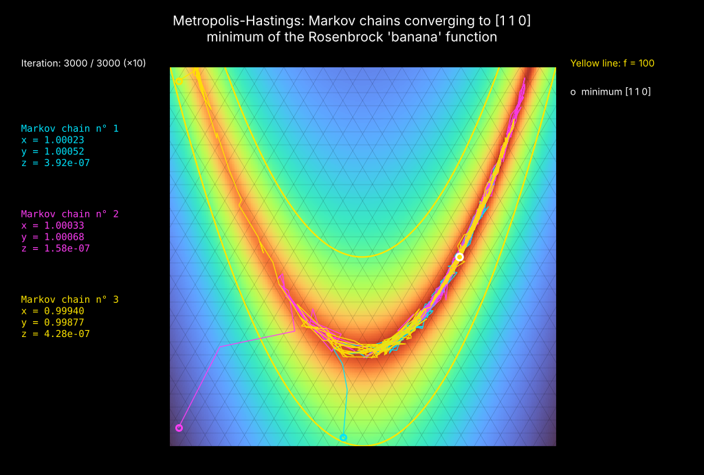
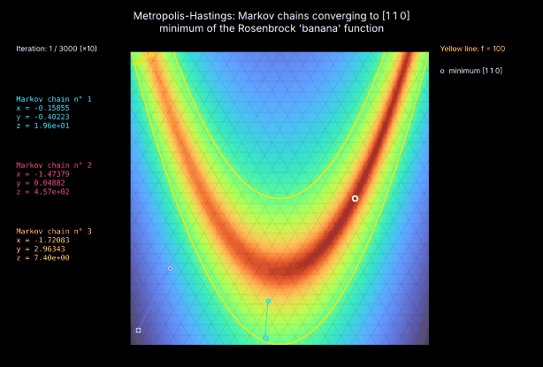
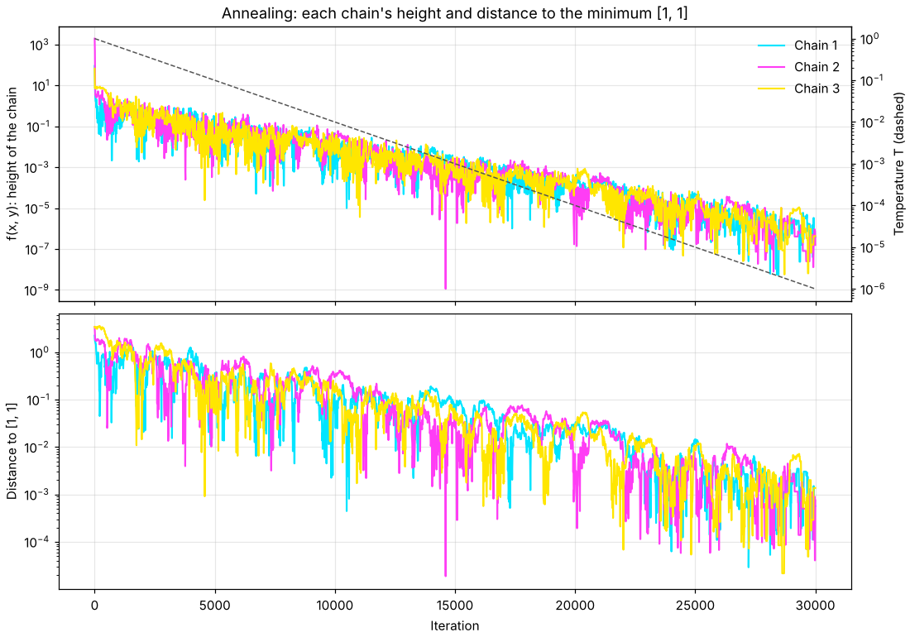
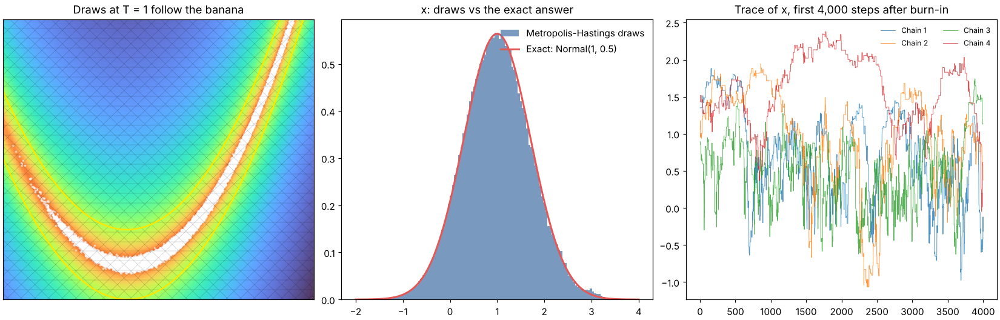

# Metropolis-Hastings: Markov chains on the Rosenbrock banana

Updated 2026-11-01 01:54 UTC · 3 chains · 30,000 steps each · seed 42 · code: [`mcsim/metropolis.py`](../mcsim/metropolis.py) · **[Audit of the algorithm →](AUDIT.md)**

## How it works

The target is the Rosenbrock function f(x, y) = (1 − x)² + 100 (y − x²)², a long curved valley whose lowest point is **[x, y, z] = [1, 1, 0]**. Each chain repeats one step:

1. **Propose** a nearby point by adding a small random (Gaussian) move to the current point.
2. **Accept** it with probability min(1, p(new) q(old | new) / [p(old) q(new | old)]), with p ∝ exp(−f / T). Downhill moves are always accepted; uphill moves sometimes, less often as T falls.
3. Otherwise **stay** where it is (the step still counts).

The next point depends only on the current point, not on how the chain got there: that is the **Markov property**. The temperature and step size follow a schedule fixed in advance, so it holds at every step.

## 1. Three chains converging to the minimum (annealing)

Temperature lowered from 1 to 1e-06 over 30,000 steps.

| Chain | Start | End x | End y | End z = f(x, y) | Distance to [1, 1] | Moves accepted |
|---|---|---|---|---|---|---|
| 1 | (-0.2, -0.9) | 1.00023 | 1.00052 | 3.92e-07 | 0.0006 | 22% |
| 2 | (-1.9, -0.8) | 1.00033 | 1.00068 | 1.58e-07 | 0.0008 | 22% |
| 3 | (-1.9, 2.85) | 0.99940 | 0.99877 | 4.28e-07 | 0.0014 | 22% |

## 2. Sampling at a fixed temperature (T = 1)

At a fixed temperature the same algorithm does not just find the minimum; it draws points in proportion to exp(−f). For this function the answer is known exactly, so the draws can be checked.

| Quantity | Metropolis-Hastings | Exact |
|---|---|---|
| Mean of x | 0.997 | 1.000 |
| Variance of x | 0.509 | 0.500 |
| Mean of y | 1.503 | 1.500 |
| Variance of y | 2.629 | 2.505 |

4 chains × 950,000 steps after burn-in · moves accepted 17% · Gelman-Rubin R̂ for x: 1.000 (1.00 = chains agree) · effective sample size of x: 2,039

## Where this fits

The ETF reports in this repo use a block-bootstrap Monte Carlo, which resamples real returns. Metropolis-Hastings is a different tool: Markov chain Monte Carlo (MCMC), used to draw from a distribution that can only be written up to a constant, such as the uncertainty in a model's parameters.
