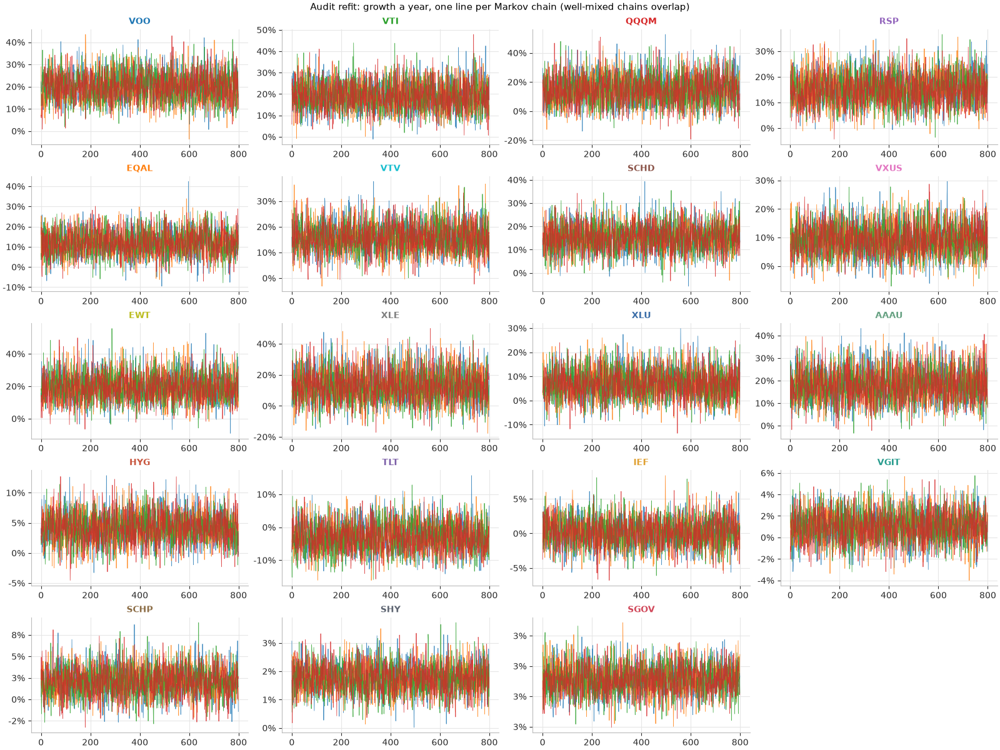

# Audit: Metropolis-Hastings on the Markov model ETFs

Run 2026-11-01 02:37 UTC · [← results](RESULTS.md) · code: [`mcsim/mh_etfs.py`](../mcsim/mh_etfs.py), [`mcsim/metropolis.py`](../mcsim/metropolis.py), audit: [`mcsim/mh_audit.py`](../mcsim/mh_audit.py)

**8 of 9 checks passed.**

| Check | Result | Detail |
|---|---|---|
| 1. Exact kernel and detailed balance | ✅ pass | detailed balance error 1.4e-17; code vs formula: largest gap 0.0015 over 2,000,000 steps; time in each state vs target: distance 0.0009 |
| 2. Markov property | ✅ pass | P(next | current, previous) vs P(next | current): largest gap 0.0066 over 15 pairs; each step receives only the current state; the ETF chains' proposal is fixed before they start |
| 3. Hastings correction | ✅ pass | with the correction: mean 1.998 (exact 2, ±0.004); without it: 0.996, wrong as expected |
| 4. Recovers known parameters | ✅ pass | 43 of 48 90% ranges contain the true value (expected about 43; pass at 38 or more) |
| 5. Same data as the Yahoo-checked bootstrap run | ✅ pass | 19 of 19 funds have the same dates and the same growth a year |
| 6. Chains converged, every fund | ✅ pass | worst R-hat 1.0035 (refit 1.0055); lowest ESS 1,461; acceptance 28–32% |
| 7. Same answer with a different seed | ✅ pass | largest change in median growth 0.05 posterior standard deviations, in median volatility 0.07 (pass below 0.25) |
| 8. Model agrees with each fund's actual figures | ❌ fail | actual mean return within 1.06 posterior standard deviations of the model's (pass below 3); model volatility / actual: 0.97–1.63 (pass 0.85–1.15) |
| 9. Predictions consistent | ✅ pass | 19 of 19 funds: the 10-year range is wider with parameter uncertainty, and the fixed-parameter median matches amount × exp(days × mean daily log return) within simulation error (largest gap 2.3 standard errors; pass below 4) |
| 10. Independent days (note) | ⚠ | model's uncertainty about the mean ÷ 20-day block-bootstrap estimate: 0.39–1.18. Below 0.8 (ranges may be too narrow): SGOV (0.39). |

## Per fund

| Fund | R-hat | Effective draws | Acceptance | Seed change: growth / volatility (sd) | Mean return gap (sd) | Model vol / actual | Uncertainty vs block bootstrap |
|---|---|---|---|---|---|---|---|
| VOO | 1.0008 | 3,988 | 30% | 0.00 / 0.04 | +0.70 | 1.101 | 1.08 |
| VTI | 1.0020 | 3,955 | 30% | 0.01 / 0.01 | +0.58 | 1.081 | 1.06 |
| QQQM | 1.0002 | 4,728 | 30% | 0.01 / 0.02 | -0.18 | 1.005 | 1.09 |
| RSP | 1.0009 | 3,540 | 31% | 0.04 / 0.01 | +0.43 | 1.055 | 0.98 |
| EQAL | 1.0010 | 4,573 | 29% | 0.01 / 0.01 | +0.14 | 1.013 | 0.97 |
| VTV | 1.0005 | 4,785 | 29% | 0.02 / 0.03 | +0.46 | 1.044 | 1.04 |
| SCHD | 1.0008 | 4,463 | 32% | 0.02 / 0.04 | +0.20 | 1.032 | 1.07 |
| VXUS | 1.0008 | 4,387 | 30% | 0.03 / 0.04 | +0.02 | 0.976 | 0.98 |
| EWT | 1.0010 | 4,268 | 30% | 0.03 / 0.01 | +0.09 | 1.016 | 1.03 |
| XLE | 1.0005 | 3,659 | 30% | 0.01 / 0.03 | +0.05 | 1.005 | 1.03 |
| XLU | 1.0007 | 4,754 | 30% | 0.00 / 0.04 | -0.41 | 0.972 | 1.04 |
| AAAU | 1.0010 | 3,959 | 31% | 0.02 / 0.01 | +0.34 | 1.028 | 1.05 |
| HYG | 1.0035 | 1,461 | 28% | 0.03 / 0.00 | -0.09 | 1.630 | 0.98 |
| TLT | 1.0009 | 4,441 | 30% | 0.05 / 0.04 | -0.26 | 0.987 | 1.02 |
| IEF | 1.0013 | 4,357 | 30% | 0.04 / 0.01 | -0.20 | 1.002 | 0.99 |
| VGIT | 1.0010 | 4,131 | 29% | 0.02 / 0.01 | -0.10 | 1.020 | 0.99 |
| SCHP | 1.0004 | 4,430 | 30% | 0.01 / 0.07 | -0.19 | 0.989 | 1.18 |
| SHY | 1.0027 | 4,289 | 29% | 0.01 / 0.03 | +0.08 | 1.210 | 0.97 |
| SGOV | 1.0005 | 4,286 | 30% | 0.02 / 0.06 | +1.06 | 1.022 | 0.39 |

## Recovery test (made-up data with known answers)

Each row: 10 years of daily returns drawn from the model with known parameters, then fitted from scratch.

| Set | Growth: true | Growth: fitted | Volatility: true | Volatility: fitted | Tails ν: true / fitted | Skew γ: true / fitted | Inside the 90% range |
|---|---|---|---|---|---|---|---|
| 1 | -25.5% | -22.6% | 22.6% | 22.5% | 4.0 / 4.2 | 0.92 / 0.90 | 4 of 4 |
| 2 | -8.7% | -7.8% | 13.6% | 13.8% | 6.0 / 5.8 | 0.95 / 0.95 | 4 of 4 |
| 3 | -51.7% | -43.5% | 41.8% | 42.6% | 3.0 / 2.9 | 0.90 / 0.94 | 3 of 4 |
| 4 | 2.6% | 1.3% | 5.5% | 5.6% | 8.0 / 8.4 | 1.00 / 1.02 | 4 of 4 |
| 5 | -50.6% | -53.0% | 29.6% | 31.8% | 3.5 / 3.3 | 0.88 / 0.88 | 3 of 4 |
| 6 | 18.2% | 10.7% | 10.3% | 10.6% | 5.0 / 4.6 | 1.05 / 1.00 | 2 of 4 |
| 7 | -25.5% | -21.2% | 22.6% | 22.9% | 4.0 / 4.4 | 0.92 / 0.93 | 4 of 4 |
| 8 | -8.7% | -3.8% | 13.6% | 13.6% | 6.0 / 5.7 | 0.95 / 0.99 | 3 of 4 |
| 9 | -51.7% | -54.6% | 41.8% | 43.0% | 3.0 / 3.0 | 0.90 / 0.89 | 4 of 4 |
| 10 | 2.6% | 2.7% | 5.5% | 5.5% | 8.0 / 8.6 | 1.00 / 0.98 | 4 of 4 |
| 11 | -50.6% | -49.2% | 29.6% | 30.2% | 3.5 / 3.3 | 0.88 / 0.86 | 4 of 4 |
| 12 | 18.2% | 19.3% | 10.3% | 10.3% | 5.0 / 5.1 | 1.05 / 1.09 | 4 of 4 |

## What the checks mean

1-3 test the Metropolis-Hastings code itself against exact answers, including a negative control that must fail. 4 tests the whole fitting method: if the 90% ranges caught the truth much less than 90% of the time, the ranges in the report would be overconfident. 5 ties the data to the Yahoo-checked bootstrap run. 6-7 show the chains settled and that the answer does not depend on the random seed. 8 shows the fitted model reproduces each fund's actual return and risk. 9 checks the prediction step. 10 is a note: the model treats days as independent, and this compares its uncertainty with a method that keeps 20-day runs of real days together.
