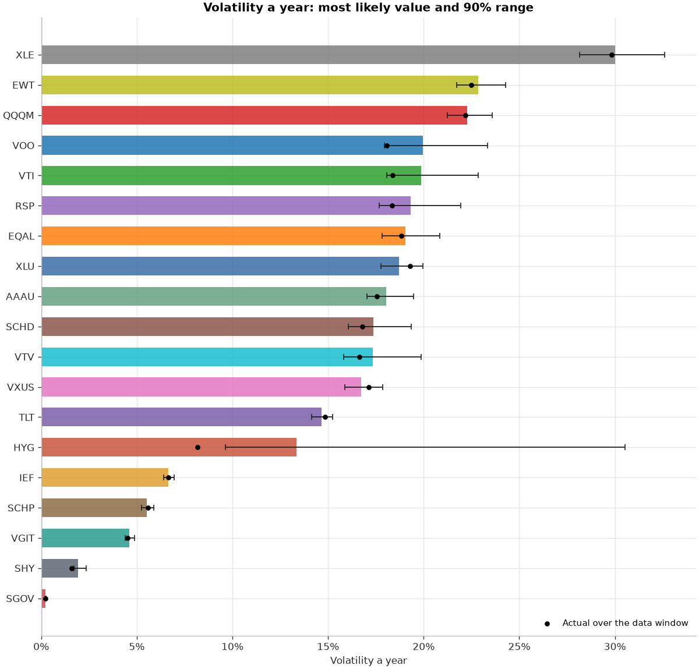

# Metropolis-Hastings: the Markov model ETFs

Updated 2026-11-01 02:35 UTC · 19 ETFs · daily Yahoo Finance prices (dividend-adjusted), last 10 years, the same window as the Markov model · $10,000 in each fund over 10 years · 10,000 simulated futures per fund · **[Audit →](AUDIT.md)**

> Research tool, not advice. The model learns only from each fund's last decade; a different decade would give different answers.

> ⚠ Under 8 years of data: QQQM, SGOV. Their ranges are wider, which is the point of this method.

## What this adds

The bootstrap report takes each fund's past decade as the truth. But ten years of noisy returns only pin down a fund's true long-run return roughly. Metropolis-Hastings measures how roughly: it draws thousands of plausible (return, risk, tail, skew) combinations, each in proportion to how well it explains the actual daily returns. Each simulated future then uses one of those combinations, so the predictions carry that uncertainty.

**Model:** daily log returns follow a skewed Student-t distribution, which allows fat tails (crashes) and bigger falls than rises. Four Markov chains per fund; the proposal's shape is learned in a pilot run and then held fixed, so the main chains keep the Markov property. Details: [`mcsim/mh_etfs.py`](../mcsim/mh_etfs.py).

**Contents:** [1. Bar diagrams](#1-bar-diagrams) · [2. Simulation prediction](#2-simulation-prediction) · [3. Model estimates](#3-model-estimates) · [Notes](#notes)

## 1. Bar diagrams

### 1a. Long-run growth a year

Bar: most likely value. Whisker: 90% range. Dot: what the fund actually returned over the data window.

### 1b. Volatility a year

### 1c. Chance of losing money over 10 years

Grey: if each fund's return and risk were known exactly. Colour: including uncertainty about them.

## 2. Simulation prediction

### 2a. Predicted value of $10,000, median (5th to 95th percentile)

| Fund | What it is | Year 1 | Year 3 | Year 5 | Year 10 | Chance of loss | Bootstrap median, year 10 |
|---|---|---|---|---|---|---|---|
| **VOO** | US large-cap (S&P 500) | **$12,037** ($8,658 – $16,549) | **$17,218** ($9,351 – $31,236) | **$24,904** ($10,693 – $57,507) | **$62,306** ($15,985 – $235,603) | 2% | $43,268 |
| **EWT** | Taiwan | **$11,949** ($7,971 – $17,553) | **$16,979** ($8,092 – $35,473) | **$24,168** ($8,578 – $65,559) | **$57,728** ($10,618 – $288,543) | 5% | $61,412 |
| **VTI** | US total market | **$11,904** ($8,463 – $16,469) | **$16,840** ($8,834 – $30,915) | **$23,797** ($9,777 – $54,523) | **$55,833** ($13,854 – $214,197) | 2% | $41,157 |
| **AAAU** | Gold | **$11,818** ($8,575 – $16,133) | **$16,354** ($8,953 – $29,598) | **$22,938** ($9,908 – $52,735) | **$51,906** ($13,115 – $202,954) | 2% | $44,455 |
| **VTV** | US value | **$11,620** ($8,626 – $15,517) | **$15,510** ($8,995 – $26,695) | **$20,839** ($9,698 – $43,793) | **$43,704** ($12,925 – $146,762) | 2% | $33,644 |
| **RSP** | US equal-weight S&P 500 | **$11,541** ($8,285 – $15,895) | **$15,390** ($8,298 – $28,249) | **$20,434** ($8,745 – $47,097) | **$41,872** ($10,880 – $160,107) | 4% | $31,490 |
| **SCHD** | US dividend payers | **$11,491** ($8,501 – $15,369) | **$15,213** ($8,635 – $25,970) | **$19,934** ($9,140 – $42,704) | **$39,723** ($11,618 – $133,626) | 3% | $35,009 |
| **QQQM** | US tech-heavy (Nasdaq-100) | **$11,484** ($7,710 – $16,940) | **$15,000** ($6,814 – $31,915) | **$19,597** ($6,430 – $58,340) | **$38,261** ($5,819 – $239,823) | 12% | $52,081 |
| **XLE** | US energy | **$11,278** ($6,696 – $18,792) | **$14,000** ($5,347 – $36,917) | **$17,979** ($4,708 – $68,491) | **$32,459** ($3,805 – $283,972) | 18% | $29,871 |
| **EQAL** | US equal-weight Russell 1000 | **$11,172** ($7,983 – $15,433) | **$13,992** ($7,518 – $25,156) | **$17,374** ($7,499 – $39,210) | **$30,333** ($7,823 – $116,806) | 9% | $27,587 |
| **VXUS** | International excluding the US | **$10,918** ($8,189 – $14,425) | **$12,969** ($7,601 – $22,184) | **$15,469** ($7,261 – $32,244) | **$23,854** ($7,019 – $78,802) | 12% | $25,354 |
| **XLU** | US utilities | **$10,706** ($7,741 – $14,676) | **$12,305** ($6,749 – $22,574) | **$14,122** ($6,154 – $32,370) | **$19,821** ($5,262 – $76,401) | 20% | $24,603 |
| **HYG** | US high-yield corporate bonds | **$10,414** ($8,809 – $12,211) | **$11,271** ($8,143 – $15,290) | **$12,208** ($7,956 – $18,567) | **$14,938** ($7,628 – $29,011) | 16% | $15,597 |
| **SGOV** | US Treasury bills, 0-3 months (cash-like) | **$10,310** ($10,269 – $10,356) | **$10,961** ($10,874 – $11,054) | **$11,652** ($11,519 – $11,793) | **$13,577** ($13,320 – $13,861) | 0% | $13,468 |
| **SCHP** | US inflation-protected Treasuries (TIPS) | **$10,218** ($9,291 – $11,227) | **$10,664** ($8,884 – $12,684) | **$11,095** ($8,670 – $14,144) | **$12,284** ($8,236 – $18,444) | 19% | $12,707 |
| **SHY** | US Treasuries, 1-3 years | **$10,174** ($9,873 – $10,504) | **$10,535** ($9,945 – $11,173) | **$10,903** ($10,077 – $11,840) | **$11,898** ($10,478 – $13,594) | 1% | $11,840 |
| **VGIT** | US Treasuries, 3-10 years | **$10,105** ($9,342 – $10,960) | **$10,308** ($8,910 – $11,961) | **$10,525** ($8,541 – $12,928) | **$11,104** ($7,877 – $15,557) | 31% | $11,259 |
| **IEF** | US Treasuries, 7-10 years | **$10,010** ($8,930 – $11,217) | **$10,045** ($8,071 – $12,389) | **$10,034** ($7,405 – $13,445) | **$10,094** ($6,219 – $16,228) | 49% | $10,606 |
| **TLT** | US Treasuries, 20+ years | **$9,709** ($7,529 – $12,502) | **$9,188** ($5,735 – $14,871) | **$8,639** ($4,525 – $16,763) | **$7,474** ($2,570 – $21,828) | 67% | $8,475 |

*Bootstrap median*: the same 10-year median from the [block-bootstrap report](../results_markov_etfs/RESULTS.md), which resamples real 20-day blocks instead of fitting a model.

### 2b. Predicted range over time

## 3. Model estimates

| Fund | Data | Growth a year: actual | Growth a year: model (90% range) | Chance true growth is below 0 | Volatility: actual | Volatility: model (90% range) | Tails ν | Skew γ |
|---|---|---|---|---|---|---|---|---|
| VOO | 2016-11-02 to 2026-10-30 (10.0 y) | 15.5% | **20.0%** (9.8% to 30.9%) | 0% | 18.1% | 20.0% (18.0% to 23.3%) | 2.7 | 0.95 |
| EWT | 2016-11-02 to 2026-10-30 (10.0 y) | 18.5% | **19.0%** (5.8% to 33.9%) | 1% | 22.5% | 22.9% (21.7% to 24.3%) | 3.9 | 0.92 |
| VTI | 2016-11-02 to 2026-10-30 (10.0 y) | 15.0% | **18.8%** (8.3% to 30.0%) | 0% | 18.4% | 19.9% (18.1% to 22.8%) | 2.8 | 0.94 |
| AAAU | 2018-08-16 to 2026-10-30 (8.2 y) | 15.5% | **17.7%** (6.8% to 29.9%) | 0% | 17.5% | 18.0% (17.0% to 19.5%) | 3.7 | 0.95 |
| VTV | 2016-11-02 to 2026-10-30 (10.0 y) | 13.1% | **15.6%** (6.8% to 25.2%) | 0% | 16.6% | 17.4% (15.8% to 19.9%) | 2.8 | 0.95 |
| RSP | 2016-11-02 to 2026-10-30 (10.0 y) | 12.4% | **15.2%** (5.6% to 25.9%) | 0% | 18.3% | 19.3% (17.7% to 22.0%) | 2.8 | 0.96 |
| SCHD | 2016-11-02 to 2026-10-30 (10.0 y) | 13.8% | **14.9%** (5.8% to 24.7%) | 0% | 16.8% | 17.4% (16.1% to 19.3%) | 3.0 | 0.96 |
| QQQM | 2020-10-14 to 2026-10-30 (6.0 y) | 15.9% | **14.3%** (-1.5% to 32.0%) | 7% | 22.2% | 22.3% (21.2% to 23.6%) | 5.0 | 0.91 |
| XLE | 2016-11-02 to 2026-10-30 (10.0 y) | 11.9% | **12.4%** (-3.3% to 30.4%) | 10% | 29.8% | 30.0% (28.2% to 32.6%) | 3.3 | 0.95 |
| EQAL | 2016-11-02 to 2026-10-30 (10.0 y) | 10.8% | **11.8%** (2.2% to 22.3%) | 2% | 18.8% | 19.1% (17.8% to 20.9%) | 3.2 | 0.93 |
| VXUS | 2016-11-02 to 2026-10-30 (10.0 y) | 9.1% | **9.0%** (0.3% to 18.7%) | 4% | 17.1% | 16.7% (15.9% to 17.9%) | 3.7 | 0.92 |
| XLU | 2016-11-02 to 2026-10-30 (10.0 y) | 9.4% | **7.0%** (-2.4% to 17.4%) | 11% | 19.3% | 18.7% (17.8% to 20.0%) | 3.7 | 0.88 |
| HYG | 2016-11-02 to 2026-10-30 (10.0 y) | 4.4% | **4.1%** (0.2% to 8.4%) | 4% | 8.2% | 13.4% (9.6% to 30.5%) | 2.2 | 0.97 |
| SGOV | 2020-06-02 to 2026-10-30 (6.4 y) | 3.0% | **3.1%** (2.9% to 3.3%) | 0% | 0.2% | 0.2% (0.2% to 0.3%) | 6.4 | 1.88 |
| SCHP | 2016-11-02 to 2026-10-30 (10.0 y) | 2.4% | **2.1%** (-0.7% to 5.0%) | 11% | 5.6% | 5.5% (5.2% to 5.9%) | 3.6 | 0.96 |
| SHY | 2016-11-02 to 2026-10-30 (10.0 y) | 1.7% | **1.8%** (0.9% to 2.6%) | 0% | 1.6% | 1.9% (1.7% to 2.4%) | 2.6 | 1.06 |
| VGIT | 2016-11-02 to 2026-10-30 (10.0 y) | 1.2% | **1.0%** (-1.3% to 3.4%) | 23% | 4.5% | 4.6% (4.4% to 4.9%) | 4.1 | 1.02 |
| IEF | 2016-11-02 to 2026-10-30 (10.0 y) | 0.6% | **0.0%** (-3.2% to 3.6%) | 49% | 6.6% | 6.7% (6.4% to 6.9%) | 5.0 | 0.99 |
| TLT | 2016-11-02 to 2026-10-30 (10.0 y) | -1.8% | **-2.8%** (-9.9% to 4.8%) | 73% | 14.8% | 14.7% (14.1% to 15.2%) | 5.6 | 0.96 |

*Tails ν*: below about 5 means crashes and spikes are far more common than a bell curve allows. *Skew γ*: below 1 means falls tend to be larger than rises.

## Notes

- Days are treated as independent. Real markets have calm and stormy spells; the bootstrap report keeps those, this model does not. The audit checks how much that matters for the return estimates.
- The ranges describe uncertainty given this decade. They cannot include risks the decade never showed.
- No taxes, inflation or currency effects beyond what is in the fund prices.

**Files:** [`chance_of_loss.png`](charts/chance_of_loss.png), [`growth_ranges.png`](charts/growth_ranges.png), [`prediction_fans.png`](charts/prediction_fans.png), [`volatility_ranges.png`](charts/volatility_ranges.png) · [`posterior_summary.csv`](tables/posterior_summary.csv), [`prediction_by_year.csv`](tables/prediction_by_year.csv), [`returns_used.csv`](tables/returns_used.csv)
