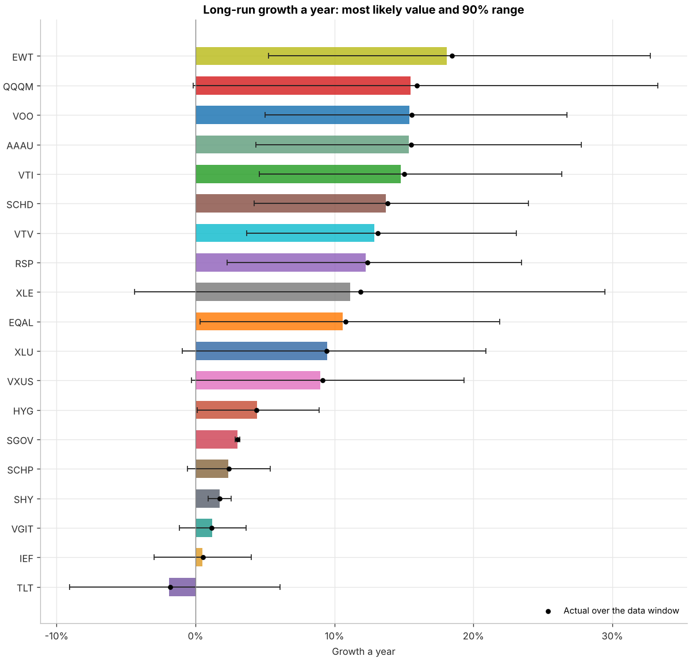
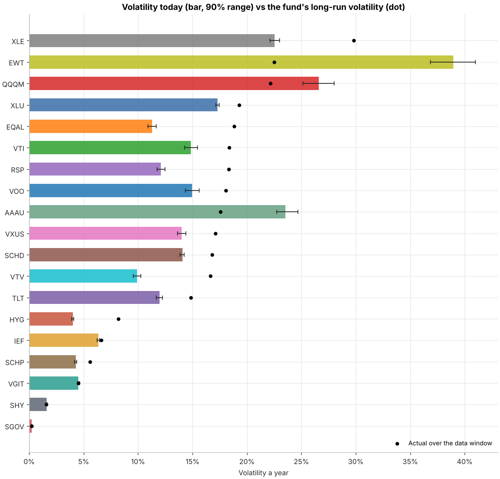
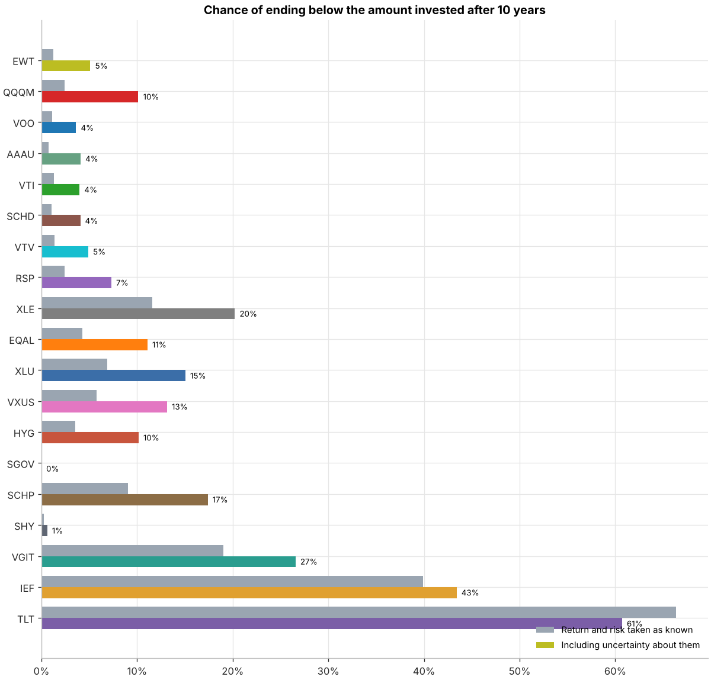
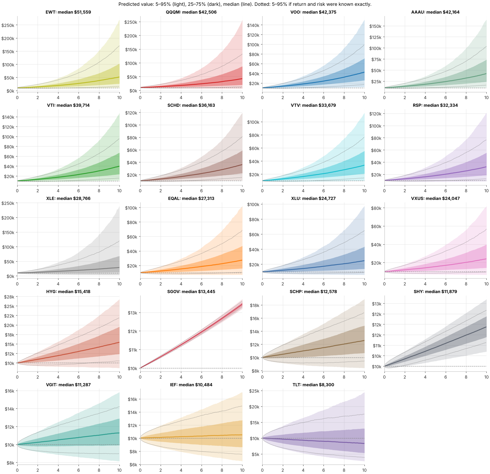

# Metropolis-Hastings: the Markov model ETFs

Updated 2026-11-01 02:51 UTC · 19 ETFs · daily Yahoo Finance prices (dividend-adjusted), last 10 years, the same window as the Markov model · $10,000 in each fund over 10 years · 10,000 simulated futures per fund · **[Audit →](AUDIT.md)**

> Research tool, not advice. The model learns only from each fund's last decade; a different decade would give different answers.

> ⚠ Under 8 years of data: QQQM, SGOV. Their ranges are wider, which is the point of this method.

## What this adds

The bootstrap report takes each fund's past decade as the truth. But ten years of noisy returns only pin down a fund's true long-run return roughly. Metropolis-Hastings measures how roughly: it draws thousands of plausible combinations of return, risk, tails and skew, each in proportion to how well it explains the actual daily returns. Each simulated future then uses one of those combinations, so the predictions carry that uncertainty.

**Model:** a GARCH volatility model with skewed Student-t shocks. Today's volatility depends on recent days, so calm and stormy spells are kept; shocks can have fat tails (crashes) and falls can be bigger than rises. The average return is anchored to the fund's actual average, with its uncertainty set by the volatility; the long-run volatility is the fund's actual volatility. Predictions start from each fund's volatility today. Four Markov chains per fund; the proposal's shape is learned in a pilot run and then held fixed, so the main chains keep the Markov property. Details: [`mcsim/mh_etfs.py`](../mcsim/mh_etfs.py).

**Contents:** [1. Bar diagrams](#1-bar-diagrams) · [2. Simulation prediction](#2-simulation-prediction) · [3. Model estimates](#3-model-estimates) · [Notes](#notes)

## 1. Bar diagrams

### 1a. Long-run growth a year

Bar: most likely value. Whisker: 90% range. Dot: what the fund actually returned over the data window.

### 1b. Volatility today vs long-run

Bar beyond the dot: a stormier spell than usual, which the predictions start from and then fade at the fund's own pace.

### 1c. Chance of losing money over 10 years

Grey: if each fund's return and risk were known exactly. Colour: including uncertainty about them.

## 2. Simulation prediction

### 2a. Predicted value of $10,000, median (5th to 95th percentile)

| Fund | What it is | Year 1 | Year 3 | Year 5 | Year 10 | Chance of loss | Bootstrap median, year 10 |
|---|---|---|---|---|---|---|---|
| **EWT** | Taiwan | **$11,896** ($7,709 – $17,607) | **$16,412** ($7,706 – $34,010) | **$22,762** ($8,163 – $62,506) | **$51,559** ($9,887 – $270,122) | 5% | $61,412 |
| **QQQM** | US tech-heavy (Nasdaq-100) | **$11,615** ($7,638 – $17,138) | **$15,549** ($6,960 – $32,676) | **$20,564** ($6,816 – $60,404) | **$42,506** ($6,394 – $257,585) | 10% | $52,081 |
| **VOO** | US large-cap (S&P 500) | **$11,625** ($8,669 – $15,018) | **$15,600** ($8,907 – $26,170) | **$20,837** ($9,496 – $43,765) | **$42,375** ($11,570 – $150,880) | 4% | $43,268 |
| **AAAU** | Gold | **$11,588** ($8,333 – $15,755) | **$15,477** ($8,513 – $27,642) | **$20,776** ($9,039 – $46,722) | **$42,164** ($10,728 – $163,947) | 4% | $44,455 |
| **VTI** | US total market | **$11,526** ($8,571 – $15,005) | **$15,257** ($8,485 – $26,228) | **$19,937** ($9,069 – $43,997) | **$39,714** ($11,010 – $147,916) | 4% | $41,157 |
| **SCHD** | US dividend payers | **$11,415** ($8,746 – $14,559) | **$14,681** ($8,777 – $24,135) | **$19,140** ($9,207 – $38,820) | **$36,163** ($10,764 – $119,458) | 4% | $35,009 |
| **VTV** | US value | **$11,343** ($8,709 – $14,462) | **$14,547** ($8,587 – $23,884) | **$18,581** ($8,879 – $37,773) | **$33,679** ($10,089 – $113,579) | 5% | $33,644 |
| **RSP** | US equal-weight S&P 500 | **$11,271** ($8,456 – $14,678) | **$14,232** ($7,984 – $24,373) | **$17,916** ($8,032 – $39,097) | **$32,334** ($8,645 – $120,947) | 7% | $31,490 |
| **XLE** | US energy | **$11,210** ($7,005 – $17,164) | **$13,825** ($5,504 – $33,961) | **$17,031** ($4,614 – $60,477) | **$28,766** ($3,415 – $239,330) | 20% | $29,871 |
| **EQAL** | US equal-weight Russell 1000 | **$11,116** ($8,257 – $14,409) | **$13,614** ($7,466 – $23,448) | **$16,733** ($7,112 – $36,193) | **$27,313** ($7,010 – $102,145) | 11% | $27,587 |
| **XLU** | US utilities | **$11,002** ($7,846 – $14,770) | **$13,082** ($7,017 – $23,777) | **$15,721** ($6,580 – $35,589) | **$24,727** ($5,899 – $97,438) | 15% | $24,603 |
| **VXUS** | International excluding the US | **$10,968** ($8,211 – $14,268) | **$13,018** ($7,419 – $22,142) | **$15,510** ($7,098 – $32,563) | **$24,047** ($6,469 – $82,004) | 13% | $25,354 |
| **HYG** | US high-yield corporate bonds | **$10,469** ($9,360 – $11,590) | **$11,411** ($9,068 – $14,202) | **$12,433** ($8,954 – $17,046) | **$15,418** ($8,661 – $26,796) | 10% | $15,597 |
| **SGOV** | US Treasury bills, 0-3 months (cash-like) | **$10,300** ($10,258 – $10,344) | **$10,928** ($10,843 – $11,018) | **$11,596** ($11,464 – $11,732) | **$13,445** ($13,192 – $13,717) | 0% | $13,468 |
| **SCHP** | US inflation-protected Treasuries (TIPS) | **$10,244** ($9,345 – $11,174) | **$10,733** ($8,964 – $12,758) | **$11,229** ($8,714 – $14,335) | **$12,578** ($8,385 – $18,890) | 17% | $12,707 |
| **SHY** | US Treasuries, 1-3 years | **$10,172** ($9,935 – $10,434) | **$10,525** ($10,079 – $10,998) | **$10,895** ($10,244 – $11,589) | **$11,879** ($10,695 – $13,204) | 1% | $11,840 |
| **VGIT** | US Treasuries, 3-10 years | **$10,117** ($9,403 – $10,911) | **$10,361** ($9,012 – $12,003) | **$10,644** ($8,733 – $12,971) | **$11,287** ($8,141 – $15,808) | 27% | $11,259 |
| **IEF** | US Treasuries, 7-10 years | **$10,053** ($9,009 – $11,215) | **$10,158** ($8,220 – $12,536) | **$10,252** ($7,612 – $13,785) | **$10,484** ($6,462 – $17,009) | 43% | $10,606 |
| **TLT** | US Treasuries, 20+ years | **$9,830** ($7,708 – $12,463) | **$9,451** ($5,881 – $15,288) | **$9,136** ($4,683 – $17,571) | **$8,300** ($2,706 – $24,454) | 61% | $8,475 |

*Bootstrap median*: the same 10-year median from the [block-bootstrap report](../results_markov_etfs/RESULTS.md), which resamples real 20-day blocks instead of fitting a model.

### 2b. Predicted range over time

## 3. Model estimates

| Fund | Data | Growth a year: actual | Growth a year: model (90% range) | Chance true growth is below 0 | Volatility: long-run | Volatility today (90% range) | Calm/stormy persistence | Tails ν | Skew γ |
|---|---|---|---|---|---|---|---|---|---|
| EWT | 2016-11-02 to 2026-10-30 (10.0 y) | 18.5% | **18.1%** (5.3% to 32.7%) | 1% | 22.5% | 38.9% (36.9% to 41.0%) | 0.968 | 8.1 | 0.86 |
| QQQM | 2020-10-14 to 2026-10-30 (6.0 y) | 15.9% | **15.5%** (-0.1% to 33.3%) | 5% | 22.2% | 26.6% (25.1% to 28.0%) | 0.980 | 10.1 | 0.85 |
| VOO | 2016-11-02 to 2026-10-30 (10.0 y) | 15.5% | **15.4%** (5.0% to 26.7%) | 1% | 18.1% | 15.0% (14.3% to 15.6%) | 0.985 | 6.7 | 0.85 |
| AAAU | 2018-08-16 to 2026-10-30 (8.2 y) | 15.5% | **15.4%** (4.3% to 27.8%) | 1% | 17.5% | 23.6% (22.7% to 24.7%) | 0.979 | 5.8 | 0.93 |
| VTI | 2016-11-02 to 2026-10-30 (10.0 y) | 15.0% | **14.8%** (4.6% to 26.3%) | 1% | 18.4% | 14.9% (14.3% to 15.5%) | 0.985 | 7.2 | 0.84 |
| SCHD | 2016-11-02 to 2026-10-30 (10.0 y) | 13.8% | **13.7%** (4.2% to 24.0%) | 1% | 16.8% | 14.1% (13.9% to 14.2%) | 0.986 | 7.2 | 0.91 |
| VTV | 2016-11-02 to 2026-10-30 (10.0 y) | 13.1% | **12.9%** (3.7% to 23.1%) | 1% | 16.6% | 9.9% (9.6% to 10.3%) | 0.978 | 7.0 | 0.87 |
| RSP | 2016-11-02 to 2026-10-30 (10.0 y) | 12.4% | **12.3%** (2.3% to 23.5%) | 2% | 18.3% | 12.1% (11.7% to 12.5%) | 0.985 | 8.1 | 0.88 |
| XLE | 2016-11-02 to 2026-10-30 (10.0 y) | 11.9% | **11.1%** (-4.4% to 29.5%) | 13% | 29.8% | 22.6% (22.1% to 23.0%) | 0.994 | 7.7 | 0.89 |
| EQAL | 2016-11-02 to 2026-10-30 (10.0 y) | 10.8% | **10.6%** (0.3% to 21.9%) | 4% | 18.8% | 11.3% (10.9% to 11.7%) | 0.986 | 9.6 | 0.86 |
| XLU | 2016-11-02 to 2026-10-30 (10.0 y) | 9.4% | **9.5%** (-0.9% to 20.9%) | 7% | 19.3% | 17.3% (17.2% to 17.4%) | 0.984 | 7.4 | 0.85 |
| VXUS | 2016-11-02 to 2026-10-30 (10.0 y) | 9.1% | **9.0%** (-0.3% to 19.3%) | 5% | 17.1% | 14.0% (13.6% to 14.4%) | 0.978 | 7.4 | 0.86 |
| HYG | 2016-11-02 to 2026-10-30 (10.0 y) | 4.4% | **4.4%** (0.1% to 8.9%) | 4% | 8.2% | 4.0% (3.9% to 4.1%) | 0.991 | 6.7 | 0.92 |
| SGOV | 2020-06-02 to 2026-10-30 (6.4 y) | 3.0% | **3.0%** (2.8% to 3.2%) | 0% | 0.2% | 0.2% (0.2% to 0.2%) | 0.355 | 6.5 | 1.85 |
| SCHP | 2016-11-02 to 2026-10-30 (10.0 y) | 2.4% | **2.4%** (-0.6% to 5.4%) | 9% | 5.6% | 4.3% (4.2% to 4.4%) | 0.984 | 8.6 | 0.96 |
| SHY | 2016-11-02 to 2026-10-30 (10.0 y) | 1.7% | **1.7%** (0.9% to 2.6%) | 0% | 1.6% | 1.6% (1.6% to 1.6%) | 0.998 | 6.0 | 1.08 |
| VGIT | 2016-11-02 to 2026-10-30 (10.0 y) | 1.2% | **1.2%** (-1.2% to 3.6%) | 19% | 4.5% | 4.5% (4.4% to 4.6%) | 0.993 | 8.9 | 1.04 |
| IEF | 2016-11-02 to 2026-10-30 (10.0 y) | 0.6% | **0.5%** (-3.0% to 4.0%) | 41% | 6.6% | 6.4% (6.3% to 6.5%) | 0.991 | 11.8 | 1.00 |
| TLT | 2016-11-02 to 2026-10-30 (10.0 y) | -1.8% | **-1.9%** (-9.1% to 6.1%) | 66% | 14.8% | 12.0% (11.7% to 12.2%) | 0.989 | 14.6 | 0.96 |

*Volatility today*: the model's estimate for the day after the data ends; above the long-run figure means a stormy spell. *Persistence*: how slowly a calm or stormy spell fades (0.99 = very slowly). *Tails ν*: below about 5 means crashes and spikes are far more common than a bell curve allows. *Skew γ*: below 1 means falls tend to be larger than rises.

## Notes

- Volatility follows a GARCH(1, 1); the average return is taken as constant (no momentum or mean reversion in returns).
- The ranges describe uncertainty given this decade. They cannot include risks the decade never showed.
- No taxes, inflation or currency effects beyond what is in the fund prices.

**Files:** [`chance_of_loss.png`](charts/chance_of_loss.png), [`growth_ranges.png`](charts/growth_ranges.png), [`prediction_fans.png`](charts/prediction_fans.png), [`volatility_today.png`](charts/volatility_today.png) · [`posterior_summary.csv`](tables/posterior_summary.csv), [`prediction_by_year.csv`](tables/prediction_by_year.csv), [`returns_used.csv`](tables/returns_used.csv)
